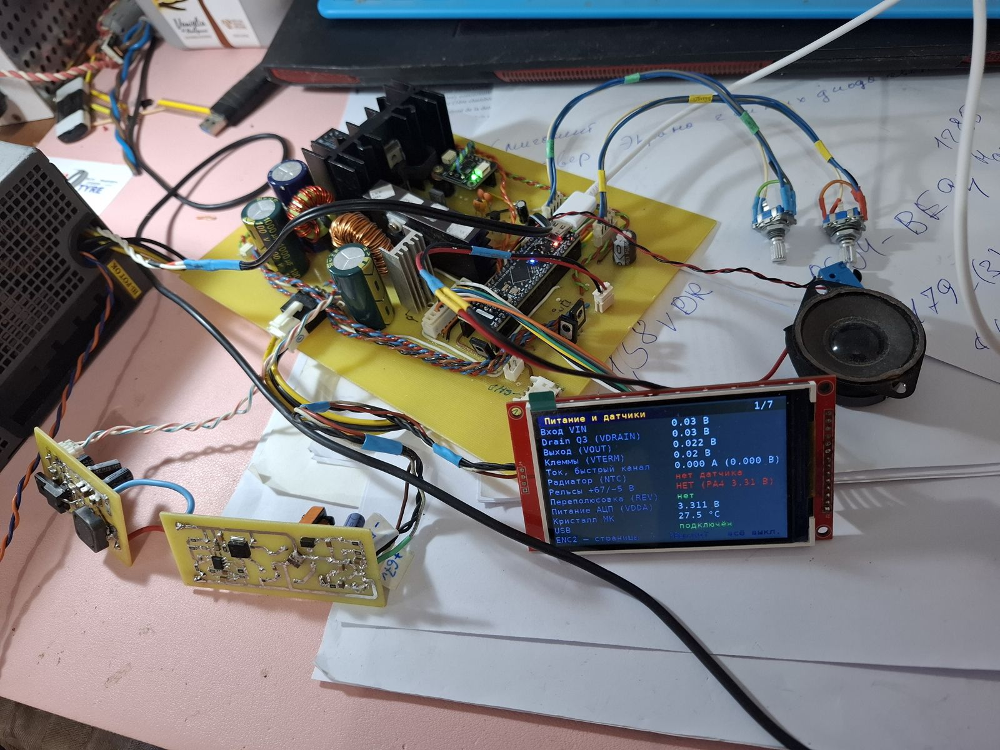
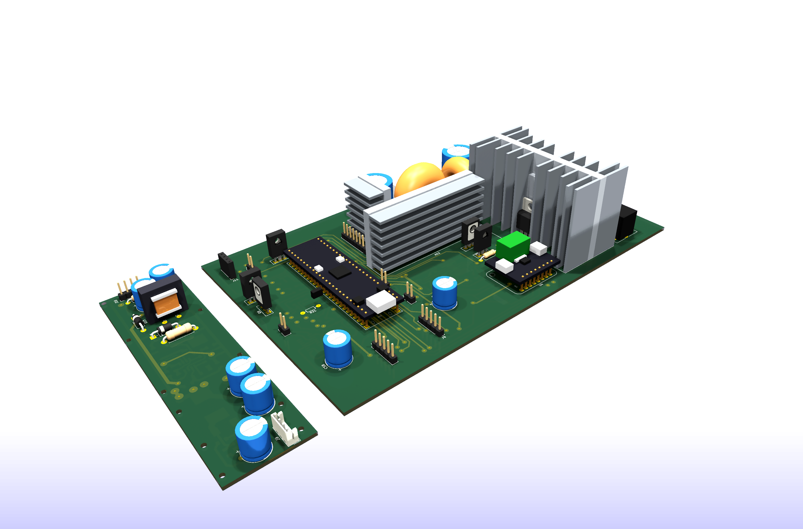
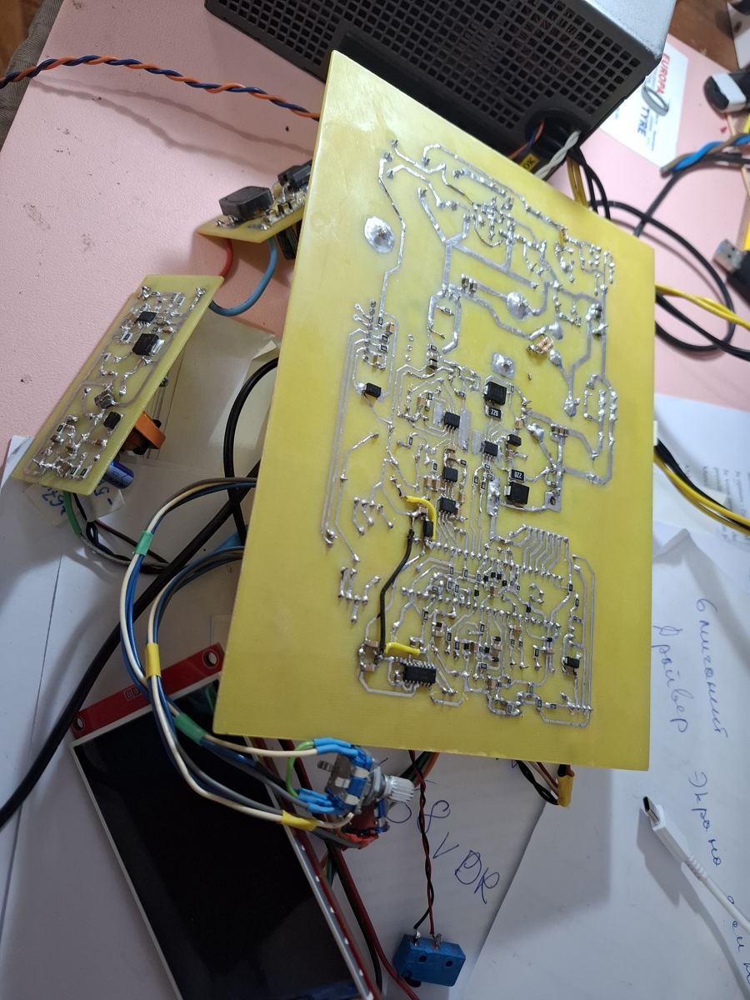

# Precision Programmable Laboratory Power Supply

[Русская версия](README.ru.md)

A hardware development project for a galvanically isolated, fully programmable laboratory power supply. The design combines a tracking synchronous buck preregulator with a fast linear post-regulator to provide high efficiency without giving up low output noise.

> **Development status (November 2026):** both boards are etched, assembled and powered up, and the device runs on bring-up firmware. Verified on the bench so far: the auxiliary rails, the linear post-regulator and the synchronous buck without load. Tests under load in amps, the current limit and calibration are still ahead, so the specification table below lists design targets; measured values are in [First measurements](#first-measurements). The KiCad sources published here are the August 2026 revision — fixes found during bring-up are not merged yet.

*The assembled boards on the bench: main board, auxiliary flyback board, and the display on the diagnostics page of the bring-up firmware (55 V input switched off for the photo).*

## Target specifications

| Parameter | Target / current design |
| --- | --- |
| Output voltage | 0–50 V programmable; expected practical lower limit approximately 20–50 mV |
| Voltage setting increment | approximately 0.84 mV; 1 mV user step |
| Current setting increment | 1 mA in firmware |
| Output ripple | no more than 1 mV target |
| Present transformer capability | approximately 5–6 A continuous, 8 A peak — the limiting element today |
| Pass-element thermal budget | 7 A continuous with the current heatsink and a silicone insulator; 10 A in short bursts under NTC foldback |
| Power-stage design target | up to 10 A after the transformer rewind (a mica insulator is then required on the pass FET) |
| Operating modes | CV, digital CC, programmable foldback, controlled output ramps |
| Controller | STM32G474 |
| Voltage reference and DAC | REF5025 + 16-bit DAC8830 |
| Voltage/current monitor | 20-bit INA228 with a Kelvin-connected 10 mΩ shunt |

## First measurements

Bring-up results from 9 November 2026, taken with bring-up firmware and before any calibration.

| Test | Result |
| --- | --- |
| Linear stage, 10.000 V setpoint into 1.5 kΩ | 10.088 V on the INA228, drift within ±2 mV over one minute; the +0.9 % offset is the uncalibrated reference |
| Zero setpoint | 0.003 V at the output |
| Buck stage, no load, 100 kHz, 55.6 V input | pass-FET drain voltage follows pulse length linearly from 12.5 V to 27.2 V |
| Buck switching node | clean rectangle, 58.8 V peak (about 3 V overshoot), no missed pulses |
| Buck no-load input power at 49 % pulse length | about 6.4 W, mostly inductor core loss — under investigation |

Not tested yet: load currents in amps, current metering scale, the tracking loop, current limit, short-circuit protection in operation, and output above 25 V.

## Full schematic

The schematic is an A1 sheet. Open the SVG directly for lossless zoom.

[Russian schematic](docs/images/lab-psu-schematic-ru.svg)

## Boards

Two home-etched single-sided boards: a main board of about 260 × 152 mm and an auxiliary flyback board that generates the +67 V / −5 V rails for the post-regulator. Connections that cannot be routed on one copper layer are made with 25 documented wire jumpers.

*Copper side of the etched and assembled main board.*

[More views, layout details and the conventions used → PCB page](docs/pcb.md)

## How it works

The mains front end is based on a modified 500 W ATX supply. Its active PFC stage creates an approximately 380 V DC bus, followed by a two-switch forward converter that provides galvanic isolation and an approximately 55 V secondary rail.

An STM32G474 controls a synchronous buck stage through HRTIM. The buck output tracks the requested output voltage while maintaining only about 2–2.5 V across the linear pass MOSFET. A damped C–L–C filter attenuates switching components before the OPA454-based linear post-regulator removes the remaining ripple.

A 16-bit DAC8830 and REF5025 establish the voltage setpoint. An INA228 measures terminal voltage and shunt current; firmware implements the programmable current limit and foldback characteristic. Fast short-circuit interception does not depend on that digital loop: the STM32 analog front end drives the hardware comparator and HRTIM break input, while firmware simultaneously clears the voltage DAC and opens the output relay.

The output stage also includes reverse-polarity detection, external-voltage detection before relay closure, overvoltage protection, backfeed supervision, a fuse, surge clamps, thermal monitoring, and an independent thermal relay interlock.

## Documentation

- [System architecture and protection design](docs/architecture.md)
- [Auxiliary +67 V / −5 V flyback converter](docs/auxiliary-flyback.md)
- [PCB design and boards](docs/pcb.md)
- [Русская техническая документация](README.ru.md)

## Hardware sources

The complete KiCad 10 project is in [`hardware/`](hardware/README.md): schematic, layout, the project footprint library, hand-written 3D models with the Python scripts that generate them, and the SKiDL script the netlist is built from.

⚠️ The boards are drawn for home etching: **every drill hole in the file is a 0.6 mm pilot** that is opened up by hand afterwards. Restore the real diameters before sending these files to a fab.

## License and reuse

The documentation, the schematic and the hardware design files are published under [CC BY-NC-ND 4.0](LICENSE): read them, study them, share them with attribution, but no commercial use and no publishing of modified versions. **Building a single unit for your own private use is explicitly permitted** — the exact terms are in [NOTICE.md](NOTICE.md).

**The firmware is not published.** The hardware does not run without it, so if you build this board the control software is yours to write. Firmware and a video of the working device will follow once the hardware has been built and tested.

## Author

Aleksei Subbotin — embedded electronics and power control, France / remote. Open to freelance and contract work: [github.com/Aleksei327](https://github.com/Aleksei327) · <alsubfr@hotmail.com>

## Safety

This project contains rectified mains and an approximately 380 V DC bus. It is an engineering prototype, not a certified product. Construction and testing require appropriate isolation, current limiting, discharge procedures, protective equipment, and experience with lethal-voltage power electronics.
