# Precision Programmable Laboratory Power Supply

[Русская версия](README.ru.md)

A hardware development project for a galvanically isolated, fully programmable laboratory power supply. The design combines a tracking synchronous buck preregulator with a fast linear post-regulator to provide high efficiency without giving up low output noise.

> **Development status (17 November 2026): the power supply is running and working.** Both boards are assembled and powered up; the synchronous buck preregulator with its tracking loop, the linear post-regulator and the digital current limit all work under load. Verified on the bench so far: regulated output from near zero to 50 V into a resistive load, a 35-minute run at 50 V / 0.63 A with the output held within 49.998–50.001 V, and the current limit holding from 1 mA to 1.5 A. Testing and assembly are in progress: operation at several amps, short-circuit behaviour, and accuracy measurements against a reference meter are next. Until those results are published, the specification table below lists design targets. The KiCad sources here are still the August 2026 revision — fixes found during bring-up are not merged yet.

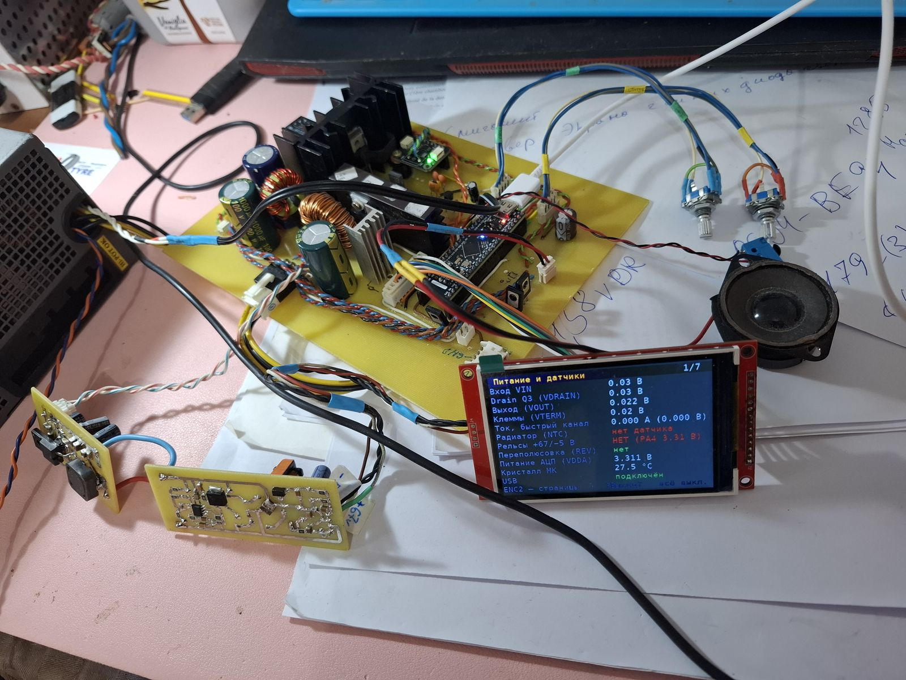

*The assembled boards on the bench: main board, auxiliary flyback board, and the display on the diagnostics page of the bring-up firmware (55 V input switched off for the photo).*

## Target specifications

| Parameter | Target / current design |
| --- | --- |
| Output voltage | 0–50 V programmable; expected practical lower limit approximately 20–50 mV |
| Voltage setting increment | approximately 0.84 mV; 1 mV user step |
| Current setting increment | 1 mA in firmware |
| Output ripple | no more than 1 mV target |
| Present transformer capability | approximately 5–6 A continuous, 8 A peak — the limiting element today |
| Pass-element thermal budget | 7 A continuous with the current heatsink and a silicone insulator; 10 A in short bursts under NTC foldback |
| Power-stage design target | up to 10 A after the transformer rewind (a mica insulator is then required on the pass FET) |
| Operating modes | CV, digital CC, programmable foldback, controlled output ramps |
| Controller | STM32G474 |
| Voltage reference and DAC | REF5025 + 16-bit DAC8830 |
| Voltage/current monitor | 20-bit INA228 with a Kelvin-connected 10 mΩ shunt |

## First measurements

Bring-up results from 9 November 2026, taken with bring-up firmware and before any calibration.

| Test | Result |
| --- | --- |
| Linear stage, 10.000 V setpoint into 1.5 kΩ | 10.088 V on the INA228, drift within ±2 mV over one minute; the +0.9 % offset is the uncalibrated reference |
| Zero setpoint | 0.003 V at the output |
| Buck stage, no load, 100 kHz, 55.6 V input | pass-FET drain voltage follows pulse length linearly from 12.5 V to 27.2 V |
| Buck switching node | clean rectangle, 58.8 V peak (about 3 V overshoot), no missed pulses |
| Buck no-load input power at 49 % pulse length | about 6.4 W, mostly inductor core loss — under investigation |

Since then (17 November 2026) the tracking loop, the current limit and output up to 50 V have been verified under load — see the status note above. Still ahead: load currents of several amps, short-circuit protection in operation, and calibrated accuracy measurements.

## The working device (November 2026)

Photos from the bench on 17 November 2026, English interface. The PC control program is available as a download — see [Firmware and PC program](#firmware-and-pc-program).

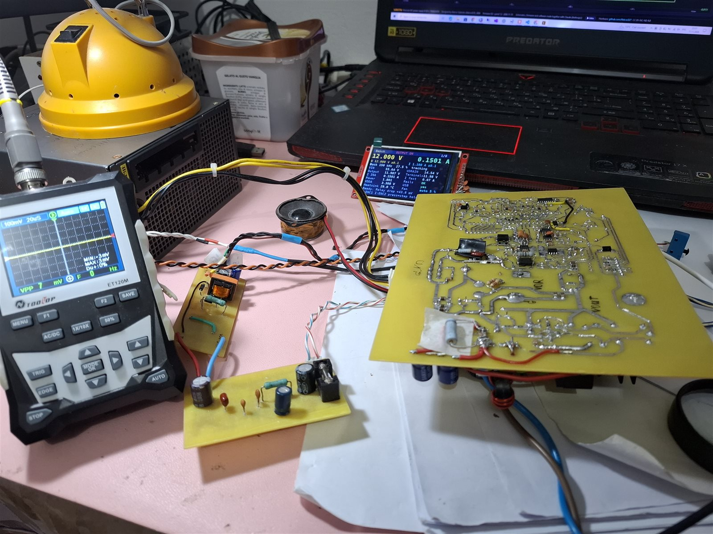

*The bench during testing: the main board (copper side up) with its auxiliary boards, the display and the oscilloscope.*

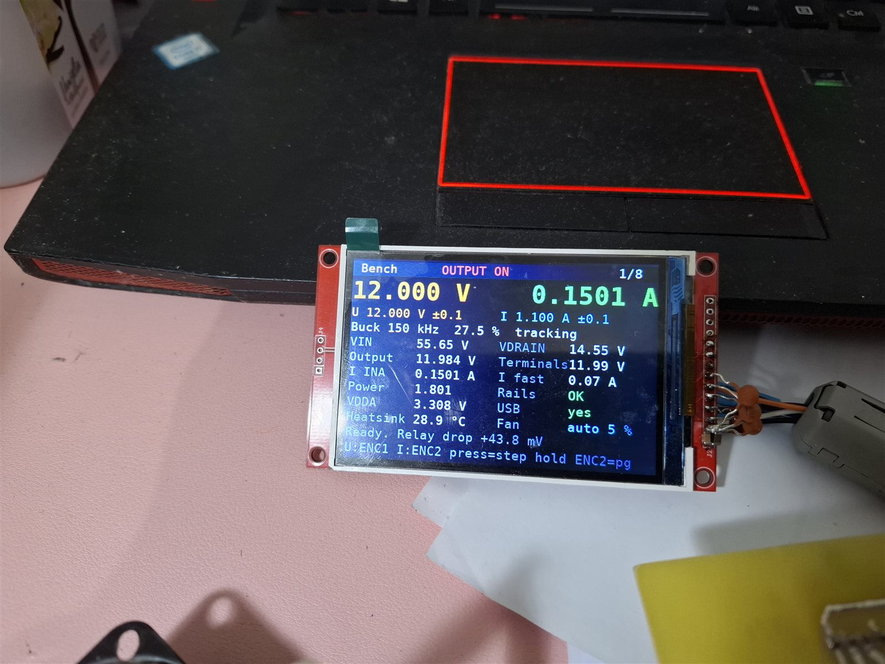

*The device display, Bench page: 12.000 V / 0.1501 A into a resistive load, buck at 150 kHz tracking the output.*

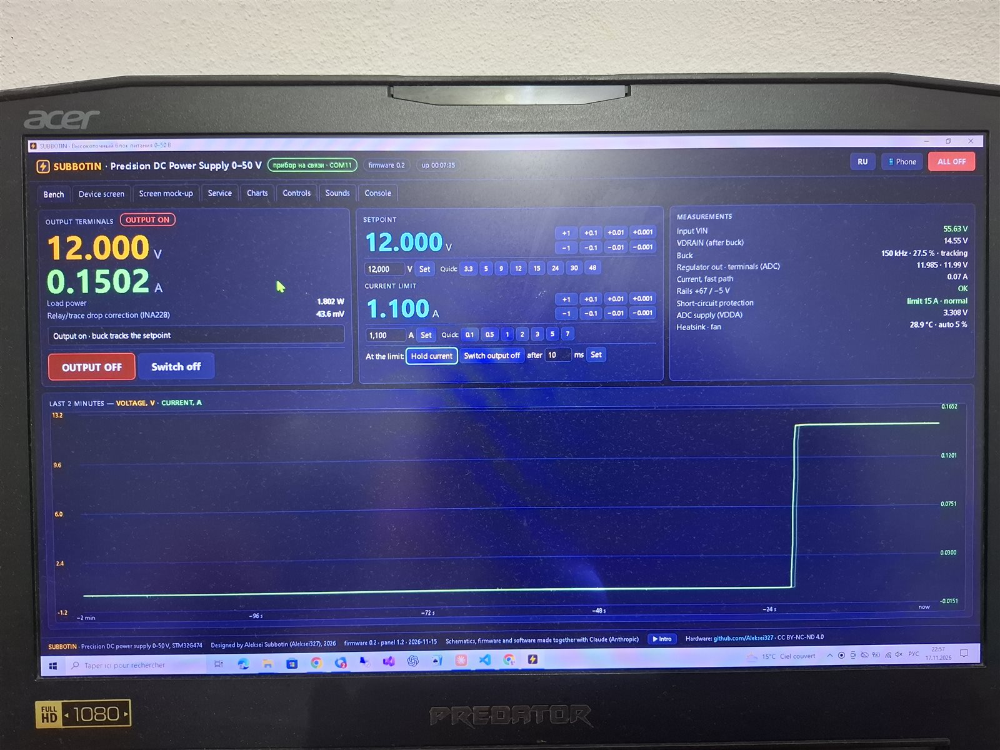

*PC control panel, Bench tab: setpoint, current limit and a live trace of output voltage and current.*

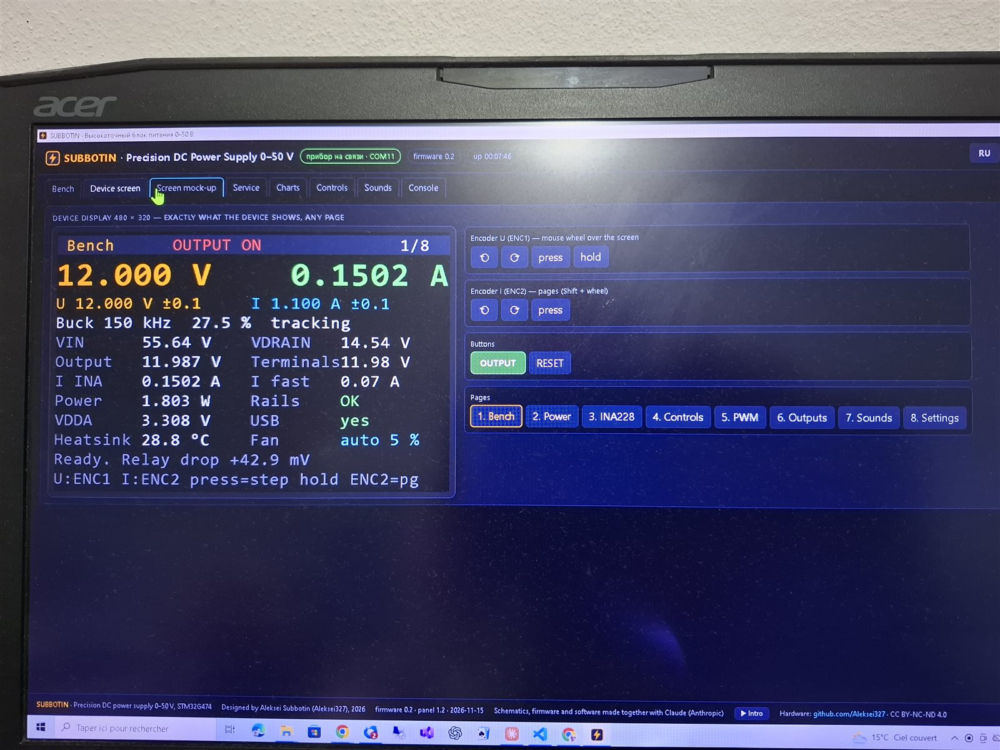

*Device screen tab: a live mirror of the instrument display, controlled from the PC.*

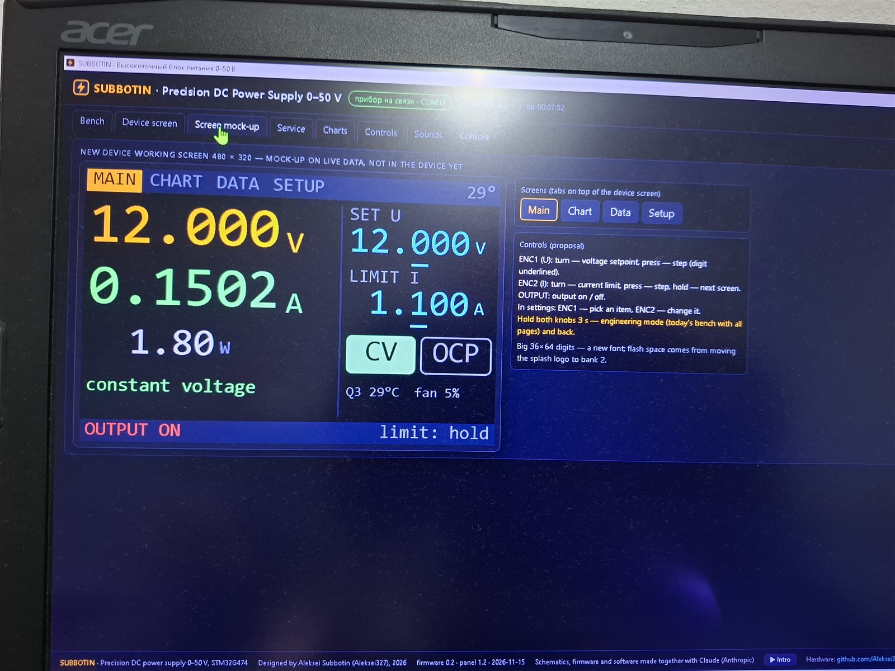

*Screen mock-up tab: the new main screen (CV/CC, OCP) running on live data.*

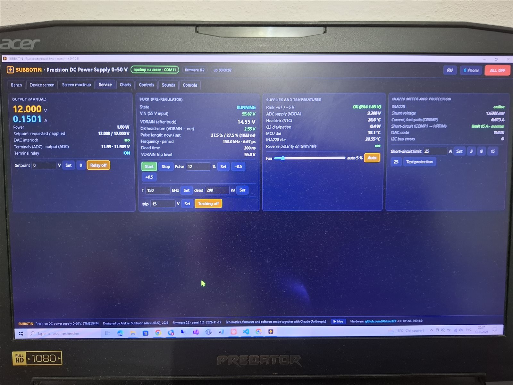

*Service tab: buck, auxiliary rails, INA228 metering and protection diagnostics.*

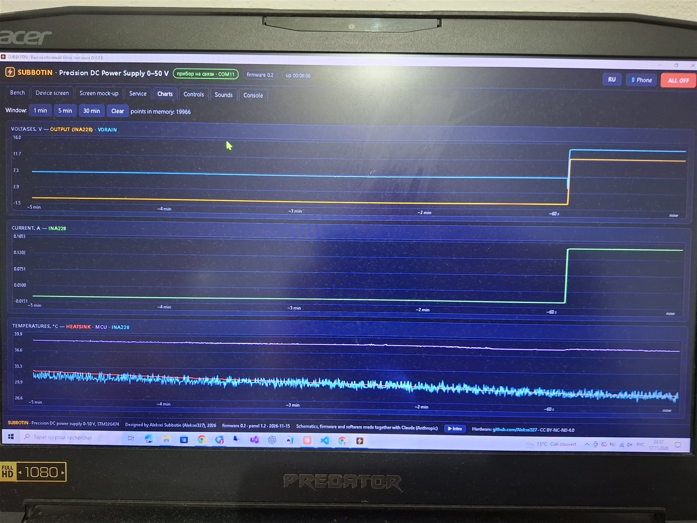

*Charts tab: output voltage, current and temperatures.*

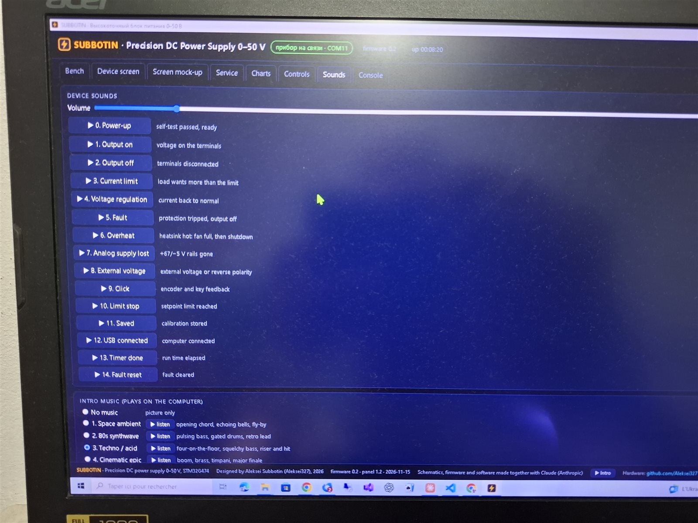

*Sounds tab: the event sounds of the device.*

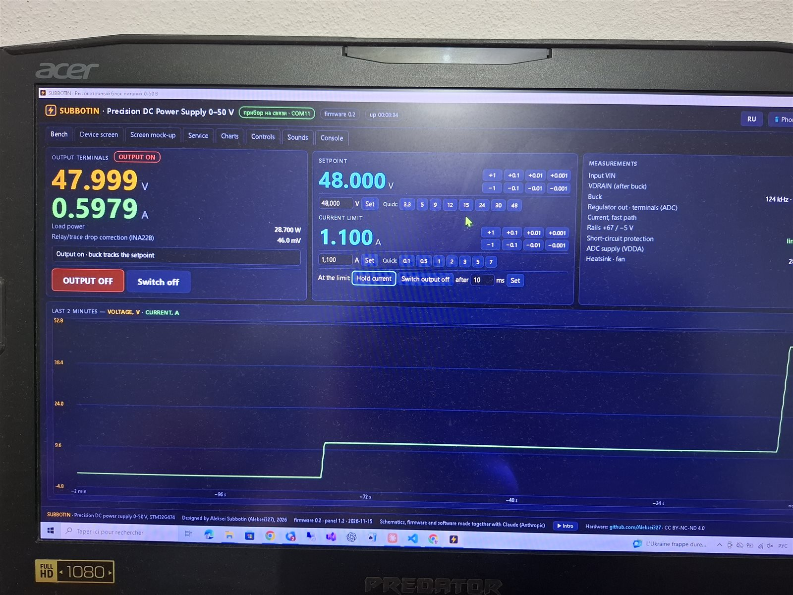

*48 V setpoint into an 80 Ω test load.*

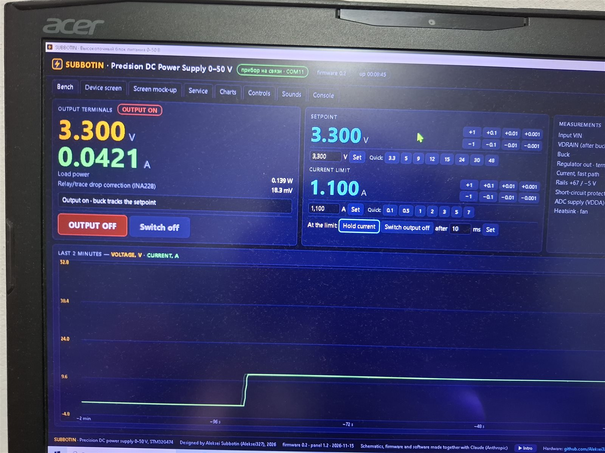

*3.3 V setpoint into the same load.*

## Firmware and PC program

**Download: [Releases](https://github.com/Aleksei327/STM32G474-Precision-Lab-Power-Supply/releases)** — the PC program for Windows, Linux and macOS, the firmware update file (`.dpfw`, uploaded from the program over USB) and the full image for a first installation on a blank STM32G474. The source code is closed; binaries only.

| Without a key | With a key — **5 € per device** |
|---|---|
| Bench in the program: readings, setpoints, output on/off; current calibration; the device screen and settings; firmware updates; all protections | Engineering mode on the device; the engineering tabs of the program (service, charts, device screen, controls, sounds, console); the charger for Li-ion, Li-ion HV (4.35 V), LiFePO4, lead-acid and NiMH |

Locked tabs can be previewed in the program before buying. To get a key, click **Copy ID** in the program and write to the developer (see [Author](#author)). Payment is by cryptocurrency, bank transfer (IBAN) or card; you get the payment details first and the key once paid.

## Full schematic

The schematic is an A1 sheet. Open the SVG directly for lossless zoom.

[Russian schematic](docs/images/lab-psu-schematic-ru.svg)

## Boards

Two boards in one KiCad file: a 4-layer main board of about 201 × 116 mm and an auxiliary flyback board of about 34 × 82 mm that generates the +67 V / −5 V rails for the post-regulator. The +12 V auxiliary supply comes from a separate small **55 → 12 V board** (UC3845 buck, its own KiCad project) — the on-board MP9486A stage of the first revision was removed.

[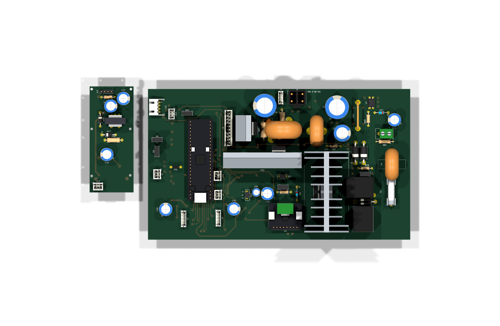](docs/pcb.md)

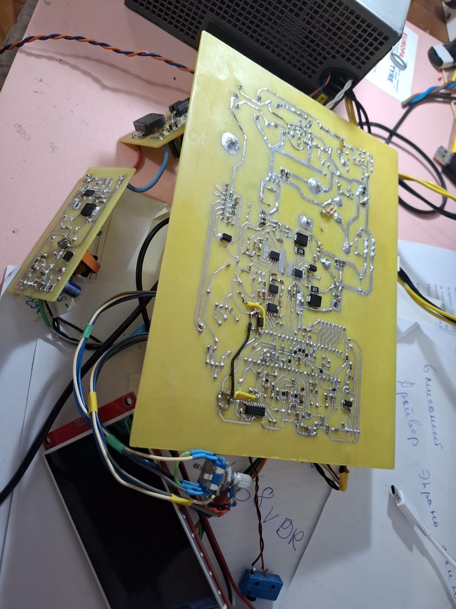

*Copper side of the etched and assembled first-revision main board.*

[More views, layout details and the conventions used → PCB page](docs/pcb.md) · [55 → 12 V board](docs/power-55-12v.md)

## Reducing output noise — plans for the next revision

What the bring-up showed and what the next board revision will change to bring the output noise down further:

- **Re-arrange the DC-DC (buck) and the linear stage** so that the high-current switching loops are as short and as small as possible — smaller loops mean less ringing and less magnetic pick-up into the regulator and the measurement circuits.
- **Common-mode filter at the buck output** (in VDRAIN and its return) so that switching noise does not ride on the ground into the precision part.
- **Split the ground into two zones joined only through that filter:**
  - *buck ground* — from the 55 V input up to the switch driver (input capacitors, switches, driver, buck inductor and its capacitors);
  - *quiet ground* — everything after the switches: the controller and all its circuitry, the DAC and reference, INA228, the OPA454 linear stage and the shunt;
  - on the buck ground stay only the sensors of the primary voltages and the buck voltage, plus the fans and the relays.

## How it works

The mains front end is based on a modified 500 W ATX supply. Its active PFC stage creates an approximately 380 V DC bus, followed by a two-switch forward converter that provides galvanic isolation and an approximately 55 V secondary rail.

An STM32G474 controls a synchronous buck stage through HRTIM. The buck output tracks the requested output voltage while maintaining only about 2–2.5 V across the linear pass MOSFET. A damped C–L–C filter attenuates switching components before the OPA454-based linear post-regulator removes the remaining ripple.

A 16-bit DAC8830 and REF5025 establish the voltage setpoint. An INA228 measures terminal voltage and shunt current; firmware implements the programmable current limit and foldback characteristic. Fast short-circuit interception does not depend on that digital loop: the STM32 analog front end drives the hardware comparator and HRTIM break input, while firmware simultaneously clears the voltage DAC and opens the output relay.

The output stage also includes reverse-polarity detection, external-voltage detection before relay closure, overvoltage protection, backfeed supervision, a fuse, surge clamps, thermal monitoring, and an independent thermal relay interlock.

## Documentation

- [System architecture and protection design](docs/architecture.md)
- [Auxiliary +67 V / −5 V flyback converter](docs/auxiliary-flyback.md)
- [PCB design and boards](docs/pcb.md)
- [55 → 12 V auxiliary supply board](docs/power-55-12v.md)
- [Русская техническая документация](README.ru.md)

## Hardware sources

The complete KiCad 10 project is in [`hardware/`](hardware/README.md): schematic, layout, the project footprint library, hand-written 3D models with the Python scripts that generate them, and the SKiDL script the netlist is built from. The 55 → 12 V board is in [`hardware/55-12V/`](hardware/55-12V/).

⚠️ The boards are drawn for home etching: **every drill hole in the file is a 0.6 mm pilot** that is opened up by hand afterwards. Restore the real diameters before sending these files to a fab.

## License and reuse

The documentation, the schematic and the hardware design files are published under [CC BY-NC-ND 4.0](LICENSE): read them, study them, share them with attribution, but no commercial use and no publishing of modified versions. **Building a single unit for your own private use is explicitly permitted** — the exact terms are in [NOTICE.md](NOTICE.md).

**The firmware and PC program source code is closed.** Ready-to-use binaries are in [Releases](https://github.com/Aleksei327/STM32G474-Precision-Lab-Power-Supply/releases); the advanced functions are unlocked by a per-device key, see [Firmware and PC program](#firmware-and-pc-program).

## Author

Aleksei Subbotin — embedded electronics and power control, France / remote. Open to freelance and contract work: [github.com/Aleksei327](https://github.com/Aleksei327) · <alsubfr@hotmail.com>

## Safety

This project contains rectified mains and an approximately 380 V DC bus. It is an engineering prototype, not a certified product. Construction and testing require appropriate isolation, current limiting, discharge procedures, protective equipment, and experience with lethal-voltage power electronics.
