# Программируемый прецизионный лабораторный блок питания

[English version](README.md)

Аппаратный проект гальванически развязанного полностью программируемого лабораторного блока питания. Трекинговый синхронный buck-предрегулятор обеспечивает высокий КПД, а быстрый линейный пострегулятор — низкий уровень выходных пульсаций.

> **Статус разработки (17 ноября 2026): блок питания запущен и работает.** Обе платы собраны и включены; синхронный buck-предрегулятор со слежением, линейный стабилизатор и цифровое ограничение тока работают под нагрузкой. На столе уже проверено: стабилизированный выход от почти нуля до 50 В на резистивной нагрузке, 35-минутный прогон на 50 В / 0,63 А с выходом в пределах 49,998–50,001 В, ограничение тока держит от 1 мА до 1,5 А. Идут испытания и сборка: дальше — работа на токах в несколько ампер, поведение при коротком замыкании и измерение точности по образцовому прибору. Пока эти результаты не опубликованы, таблица характеристик ниже — это проектные цели. Опубликованные здесь исходники KiCad — по-прежнему ревизия августа 2026 года, исправления, найденные при наладке, в них пока не внесены.

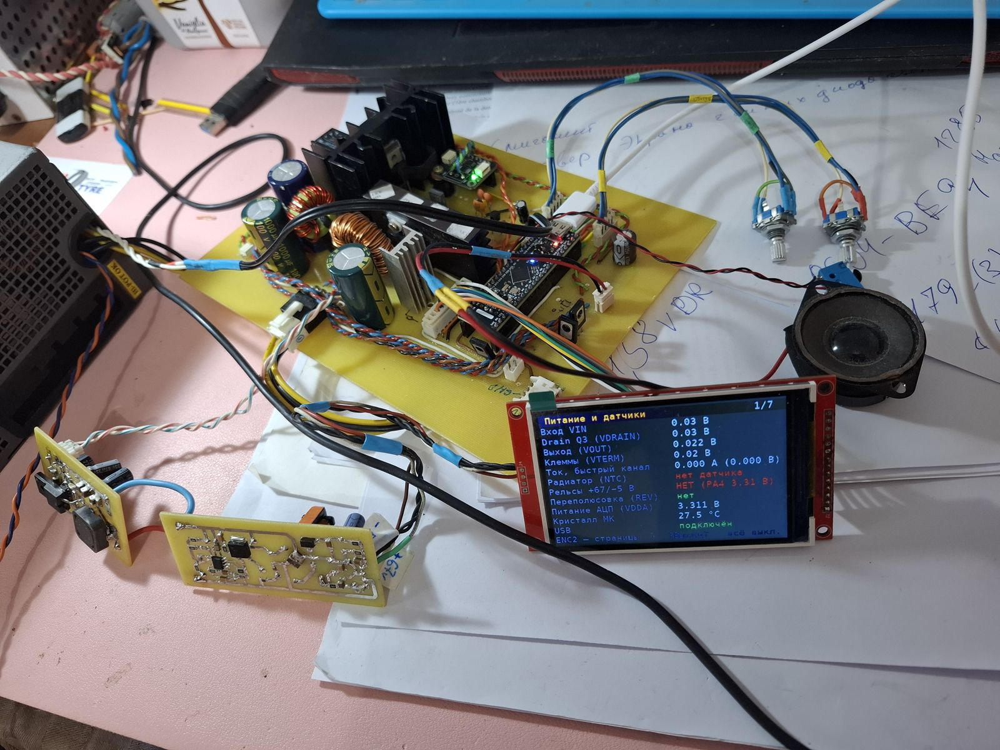

*Собранные платы на столе: основная, вспомогательная (обратноходовой преобразователь) и дисплей со страницей диагностики наладочной прошивки (вход 55 В на фото выключен).*

## Целевые параметры

| Параметр | Цель / текущая реализация |
| --- | --- |
| Выходное напряжение | программируемые 0–50 В; ожидаемый практический нижний предел около 20–50 мВ |
| Дискретность установки напряжения | около 0,84 мВ; пользовательский шаг 1 мВ |
| Дискретность установки тока | 1 мА в прошивке |
| Выходные пульсации | целевое значение не более 1 мВ |
| Возможности установленного трансформатора | около 5–6 А длительно, 8 А кратковременно — сегодня это ограничивающее звено |
| Тепловой бюджет проходного элемента | 7 А длительно на имеющемся радиаторе с силиконовой прокладкой; 10 А короткими выходами под NTC-foldback |
| Цель силовой части | до 10 А после перемотки трансформатора (тогда на проходной MOSFET нужна слюдяная прокладка) |
| Режимы | CV, цифровой CC, программируемый foldback, управляемые рампы выхода |
| Контроллер | STM32G474 |
| Опора и ЦАП напряжения | REF5025 + 16-битный DAC8830 |
| Измерение напряжения и тока | 20-битный INA228 и 10 мОм шунт с кельвиновским подключением |

## Первые измерения

Результаты наладки 9 ноября 2026 года, на наладочной прошивке и до калибровки.

| Проверка | Результат |
| --- | --- |
| Линейный стабилизатор, уставка 10,000 В на нагрузке 1,5 кОм | 10,088 В по INA228, уход в пределах ±2 мВ за минуту; сдвиг +0,9 % — некалиброванный опорный источник |
| Нулевая уставка | 0,003 В на выходе |
| Buck без нагрузки, 100 кГц, вход 55,6 В | напряжение на drain проходного транзистора линейно идёт за длиной импульса от 12,5 до 27,2 В |
| Узел коммутации buck | чистый прямоугольник, пик 58,8 В (выброс около 3 В), пропусков импульсов нет |
| Потребление buck без нагрузки при длине импульса 49 % | около 6,4 Вт, в основном потери в сердечнике дросселя — разбираемся |

С тех пор (17 ноября 2026) под нагрузкой проверены контур слежения, ограничение тока и выход до 50 В — см. статус выше. Впереди: токи нагрузки в несколько ампер, защита от короткого замыкания в работе и измерения точности после калибровки.

## Работающий прибор (ноябрь 2026)

Фото со стола 17 ноября 2026 года, английский интерфейс. Программу управления с компьютера можно скачать — см. [Прошивка и программа](#прошивка-и-программа).

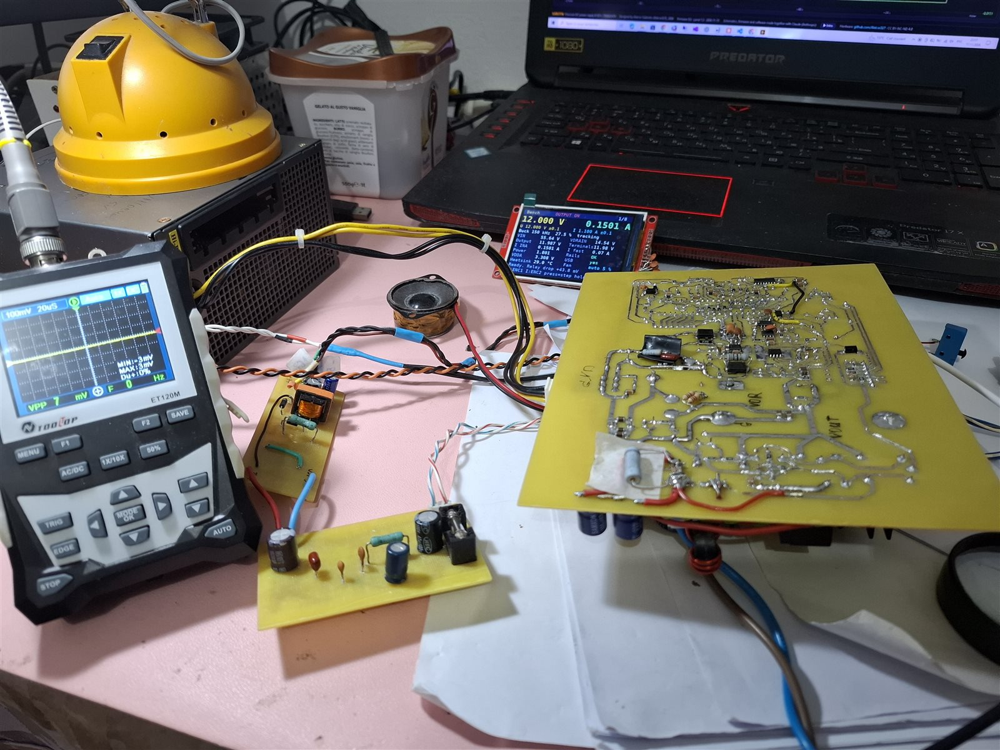

*Стол во время испытаний: основная плата (сторона меди вверх) со вспомогательными платами, дисплей и осциллограф.*

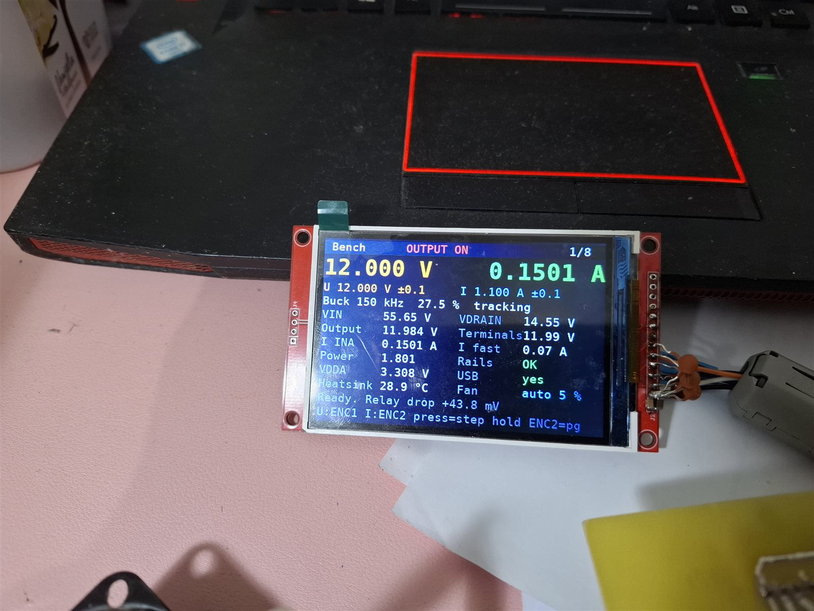

*Дисплей прибора, страница Bench: 12,000 В / 0,1501 А на резистивной нагрузке, buck на 150 кГц следит за выходом.*

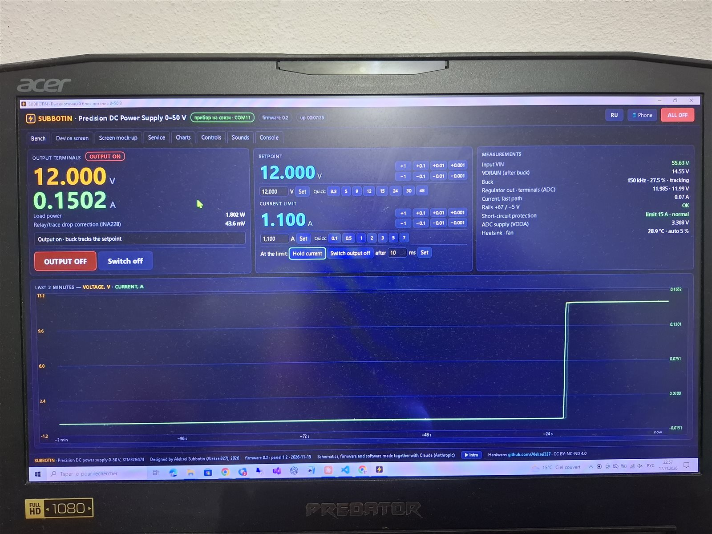

*Программа управления с компьютера, вкладка Bench: уставка, ограничение тока и живой график напряжения и тока.*

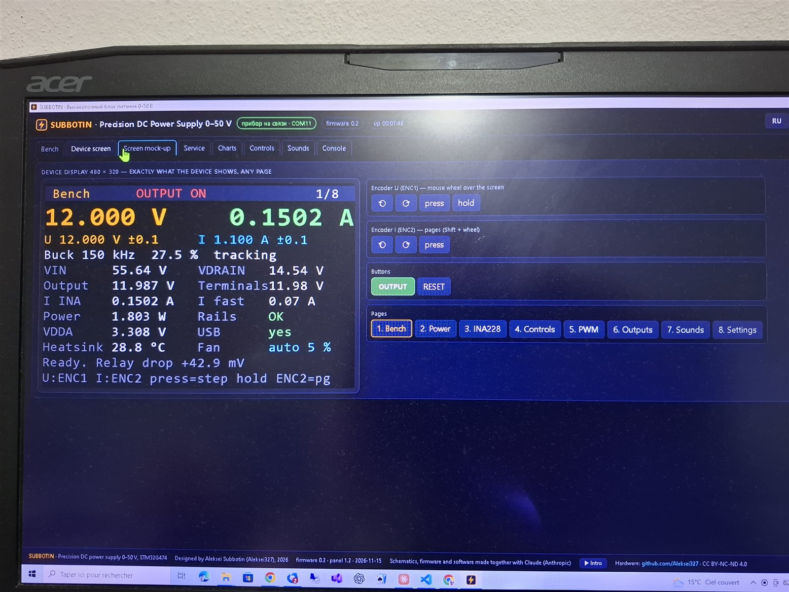

*Вкладка Device screen: живое зеркало дисплея прибора с управлением с компьютера.*

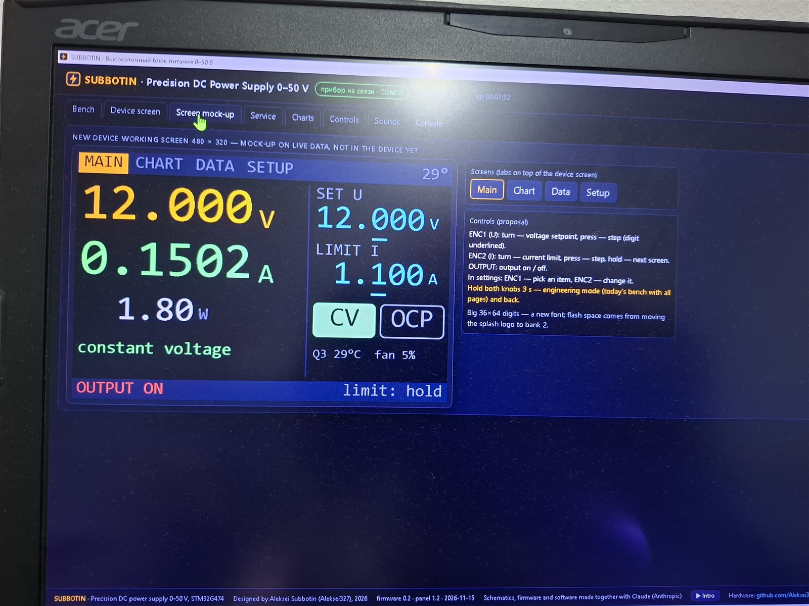

*Вкладка Screen mock-up: новый главный экран (CV/CC, OCP) на живых данных.*

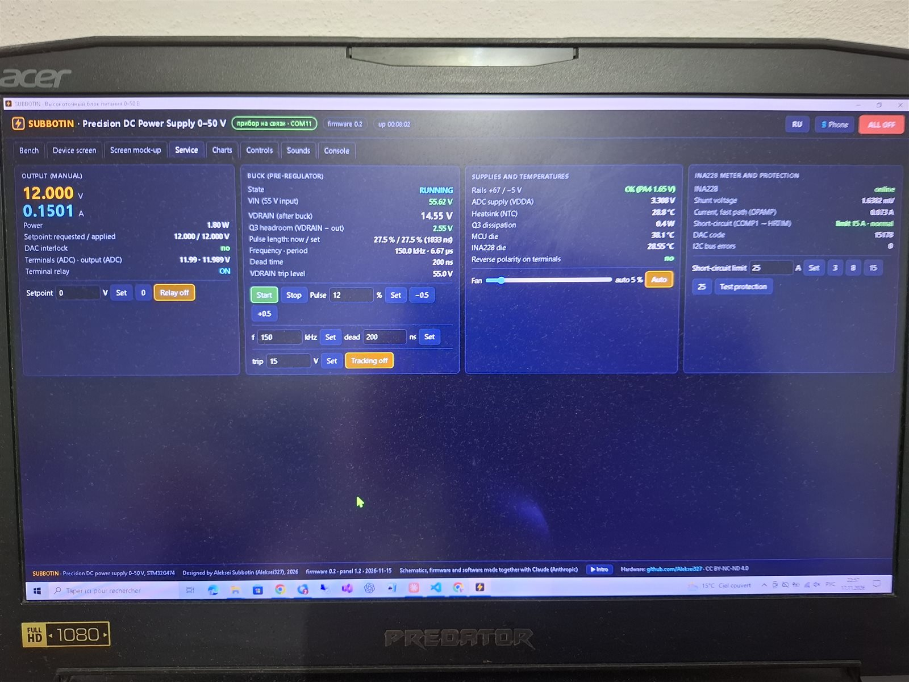

*Вкладка Service: диагностика buck, вспомогательных питаний, измерителя INA228 и защит.*

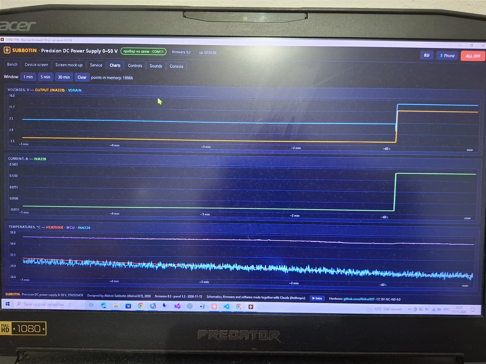

*Вкладка Charts: графики выходного напряжения, тока и температур.*

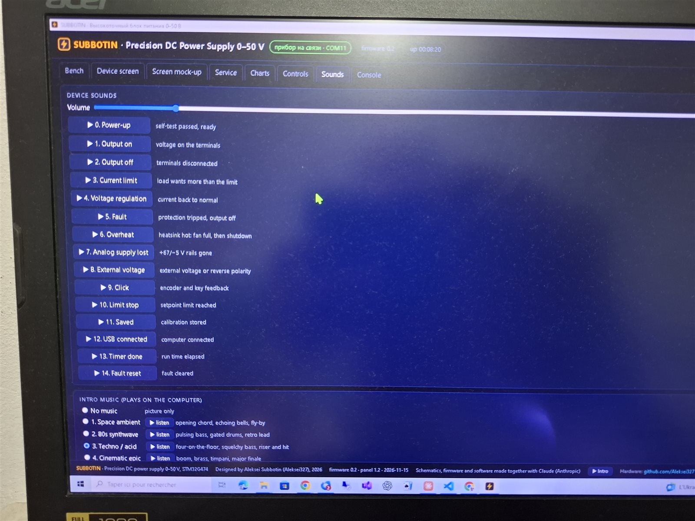

*Вкладка Sounds: звуки событий прибора.*

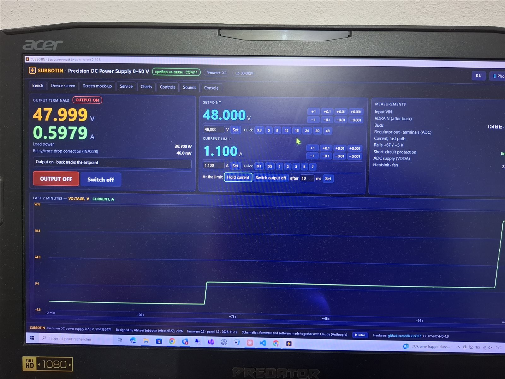

*Уставка 48 В на тестовой нагрузке 80 Ом.*

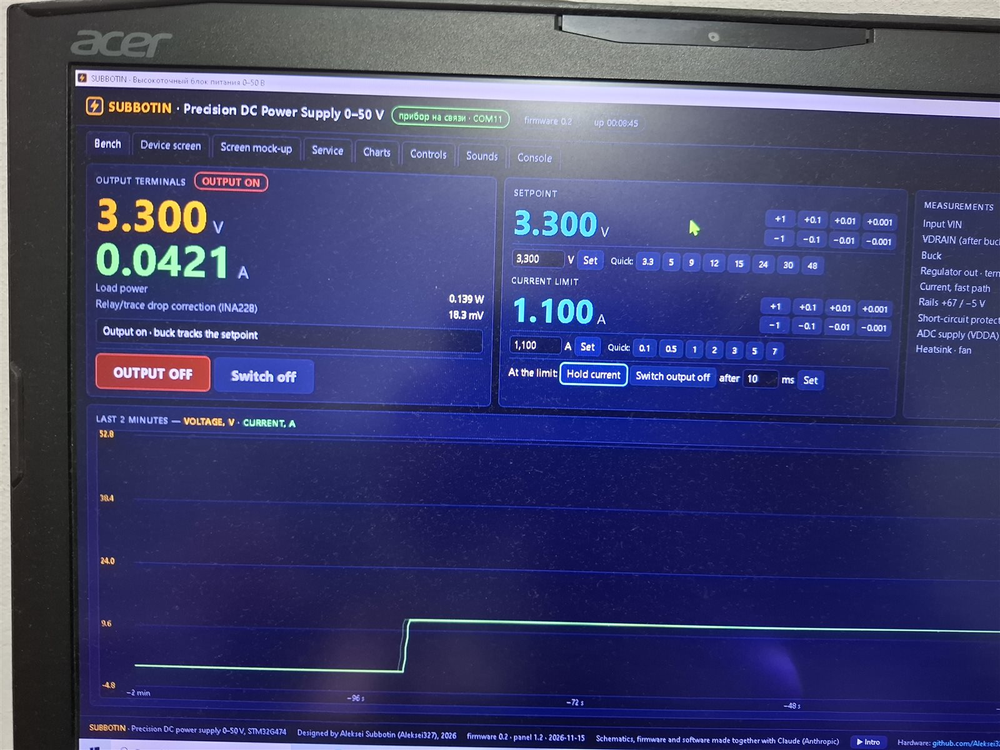

*Уставка 3,3 В на той же нагрузке.*

## Прошивка и программа

**Скачать: [Releases](https://github.com/Aleksei327/STM32G474-Precision-Lab-Power-Supply/releases)** — программа для Windows, Linux и macOS, файл обновления прошивки (`.dpfw`, загружается из программы по USB) и полный образ для первой установки на чистый STM32G474. Исходники закрыты, выкладываются только готовые файлы.

| Без ключа | С ключом — **5 € за прибор** |
|---|---|
| Стенд в программе: показания, уставки, включение выхода; калибровка тока; экран и настройки прибора; обновление прошивки; все защиты | Инженерный режим на приборе; инженерные вкладки программы (наладка, графики, экран прибора, органы управления, звуки, консоль); зарядник для Li-ion, Li-ion HV (4,35 В), LiFePO4, свинцовых и NiMH |

Закрытые вкладки можно посмотреть в программе в режиме предпросмотра до покупки. Чтобы получить ключ, нажмите в программе **Скопировать ID** и напишите разработчику (см. [Автор](#автор)). Оплата криптовалютой, банковским переводом (IBAN) или картой: сначала придут реквизиты, после оплаты — ключ.

## Полная схема

Схема выполнена на листе A1. Откройте SVG отдельно для увеличения без потери качества.

[Схема с английскими надписями](docs/images/lab-psu-schematic-en.svg)

## Платы

Две платы под домашнее травление в одном файле KiCad: основная односторонняя примерно 201 × 116 мм и вспомогательная с флайбэком примерно 34 × 82 мм, формирующим рельсы +67 В / −5 В для пострегулятора. Вспомогательное питание +12 В даёт отдельная маленькая **плата 55 → 12 В** (buck на UC3845, свой проект KiCad) — узел на MP9486A из первой ревизии снят.

**Односторонняя:** травится только нижний слой меди (B.Cu). Дорожки на F.Cu, In1.Cu и In2.Cu — **не слои меди**: так по слоям нарисованы навесные проволочные перемычки и витые пары, всё, что на них, идёт навесом.

[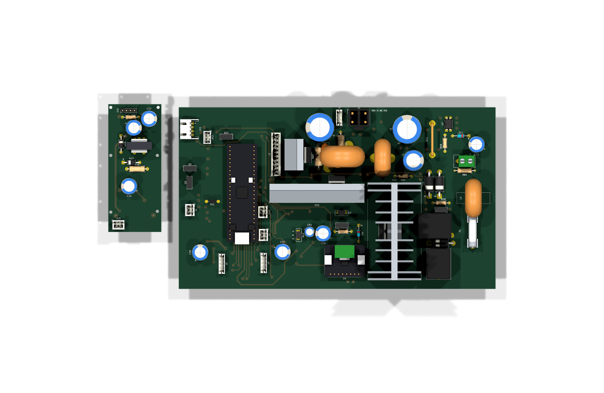](docs/pcb.ru.md)

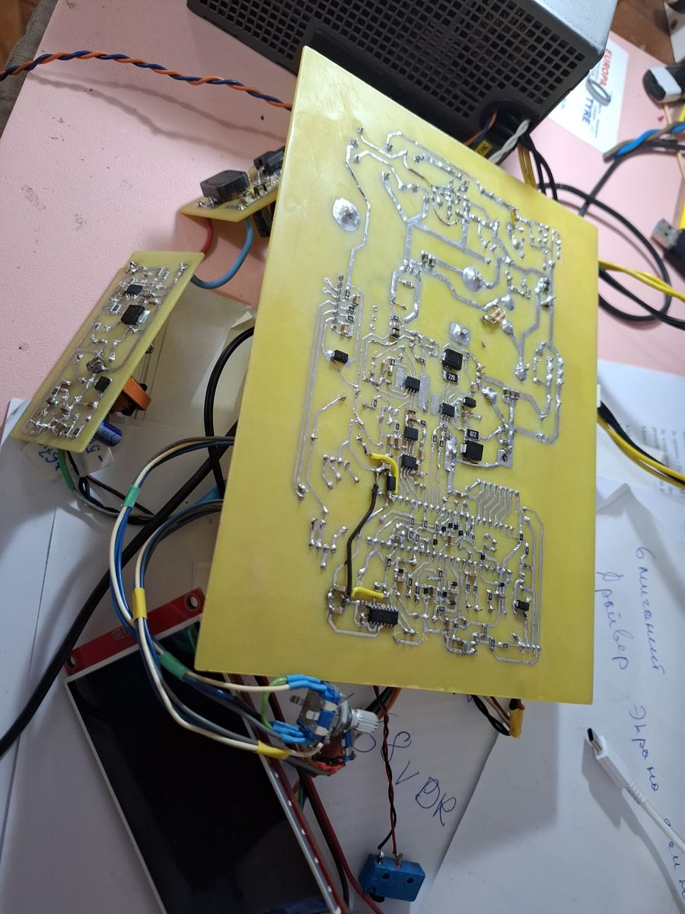

*Сторона меди вытравленной и собранной основной платы первой ревизии.*

[Ещё виды, детали разводки и принятые соглашения → страница платы](docs/pcb.ru.md) · [Плата 55 → 12 В](docs/power-55-12v.ru.md)

## Как снизить помехи на выходе — план следующей ревизии

Что показала наладка и что изменится в следующей ревизии платы, чтобы ещё уменьшить помехи на выходе:

- **Перекомпоновать DC-DC (buck) и линейный стабилизатор** так, чтобы силовые импульсные петли стали как можно короче и меньше по площади — меньше петля, меньше звон и наводки на стабилизатор и измерительные цепи.
- **Синфазный фильтр на выходе buck** (в VDRAIN и его обратном проводе), чтобы импульсная помеха не уходила по земле в точную часть.
- **Разделить землю на две зоны, связанные только через этот фильтр:**
  - *земля buck* — от входа 55 В до драйвера ключей (входные конденсаторы, ключи, драйвер, дроссель buck и его конденсаторы);
  - *тихая земля* — всё, что за ключами: контроллер и вся его обвязка, ЦАП и опора, INA228, линейный каскад на OPA454 и шунт;
  - на земле buck остаются только датчики первичных напряжений и напряжения buck, а также вентиляторы и реле.

## Принцип работы

Сетевая часть построена на основе доработанного ATX-блока мощностью 500 Вт. Активный PFC формирует шину около 380 В, после которой двухключевой прямоходовый преобразователь обеспечивает гальваническую развязку и вторичную шину около 55 В.

STM32G474 через HRTIM управляет синхронным buck-преобразователем. Его выход отслеживает заданное напряжение, поддерживая на линейном проходном MOSFET падение около 2–2,5 В. Демпфированный C–L–C-фильтр подавляет коммутационные составляющие, а линейный пострегулятор на OPA454 убирает остаточные пульсации.

Уставку напряжения формируют 16-битный DAC8830 и опора REF5025. INA228 измеряет напряжение на клеммах и ток шунта; прошивка реализует программируемое ограничение тока и foldback. Быстрый перехват короткого замыкания не зависит от цифрового контура: аналоговый тракт STM32 воздействует на аппаратный компаратор и вход HRTIM BRK, одновременно прошивка обнуляет ЦАП напряжения и размыкает выходное реле.

Выход также защищён от переполюсовки, внешнего напряжения до включения реле, перенапряжения, обратной передачи энергии и перегрева. Предусмотрены предохранитель, импульсные ограничители и независимый термовыключатель в цепи реле.

## Документация

- [Архитектура и система защит](docs/architecture.ru.md)
- [Вспомогательный флайбэк +67 В / −5 В](docs/auxiliary-flyback.ru.md)
- [Печатные платы](docs/pcb.ru.md)
- [Плата питания 55 → 12 В](docs/power-55-12v.ru.md)
- [English technical documentation](README.md)

## Исходники аппаратной части

Полный проект KiCad 10 лежит в [`hardware/`](hardware/README.ru.md): схема, разводка, библиотека посадочных мест проекта, самодельные 3D-модели вместе с генерирующими их скриптами на Python и скрипт SKiDL, из которого строится нетлист.

⚠️ Платы нарисованы под домашнее травление: **все отверстия в файле — пилотные 0,6 мм**, которые потом рассверливаются по месту. Перед отправкой файлов на фабрику верните настоящие диаметры.

## Лицензия и повторение

Документация, схема и файлы конструкции опубликованы по лицензии [CC BY-NC-ND 4.0](LICENSE): читать, изучать и делиться со ссылкой на автора можно, коммерческое использование и публикация переделанных версий запрещены. **Собрать один экземпляр для личного пользования прямо разрешается** — точные условия в [NOTICE.md](NOTICE.md).

**Исходники прошивки и программы закрыты.** Готовые файлы — в [Releases](https://github.com/Aleksei327/STM32G474-Precision-Lab-Power-Supply/releases); расширенные функции открываются ключом, своим для каждого прибора, см. [Прошивка и программа](#прошивка-и-программа).

## Автор

Алексей Субботин — встраиваемая электроника и силовое управление, Франция / удалённо. Открыт для внештатной и контрактной работы: [github.com/Aleksei327](https://github.com/Aleksei327) · <alsubfr@hotmail.com>

## Безопасность

В проекте присутствуют выпрямленное сетевое напряжение и шина около 380 В постоянного тока. Это инженерный прототип, а не сертифицированное изделие. Сборка и испытания требуют гальванической развязки измерительного оборудования, ограничения тока, контролируемого разряда конденсаторов, средств защиты и опыта работы с опасными напряжениями.
