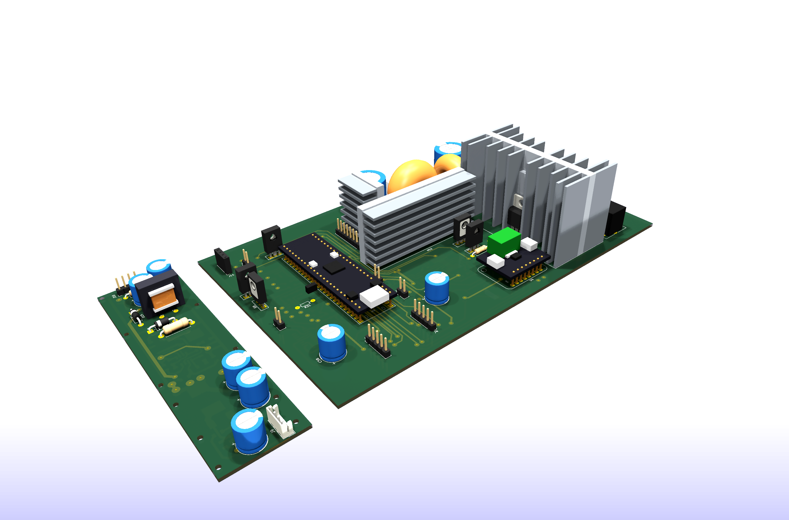

# Программируемый прецизионный лабораторный блок питания

[English version](README.md)

Аппаратный проект гальванически развязанного полностью программируемого лабораторного блока питания. Трекинговый синхронный buck-предрегулятор обеспечивает высокий КПД, а быстрый линейный пострегулятор — низкий уровень выходных пульсаций.

> **Статус разработки:** схема и разводка платы для текущей ревизии завершены, исходники KiCad опубликованы. Прошивка в разработке, ни одна плата ещё не изготовлена и не запущена — все цифры ниже являются проектными целями, а не измерениями.

## Целевые параметры

| Параметр | Цель / текущая реализация |
| --- | --- |
| Выходное напряжение | программируемые 0–50 В; ожидаемый практический нижний предел около 20–50 мВ |
| Дискретность установки напряжения | около 0,84 мВ; пользовательский шаг 1 мВ |
| Дискретность установки тока | 1 мА в прошивке |
| Выходные пульсации | целевое значение не более 1 мВ |
| Возможности установленного трансформатора | около 5–6 А длительно, 8 А кратковременно — сегодня это ограничивающее звено |
| Тепловой бюджет проходного элемента | 7 А длительно на имеющемся радиаторе с силиконовой прокладкой; 10 А короткими выходами под NTC-foldback |
| Цель силовой части | до 10 А после перемотки трансформатора (тогда на проходной MOSFET нужна слюдяная прокладка) |
| Режимы | CV, цифровой CC, программируемый foldback, управляемые рампы выхода |
| Контроллер | STM32G474 |
| Опора и ЦАП напряжения | REF5025 + 16-битный DAC8830 |
| Измерение напряжения и тока | 20-битный INA228 и 10 мОм шунт с кельвиновским подключением |

## Полная схема

Схема выполнена на листе A1. Откройте SVG отдельно для увеличения без потери качества.

[Схема с английскими надписями](docs/images/lab-psu-schematic-en.svg)

## Платы

Две односторонние платы под домашнее травление: основная примерно 260 × 152 мм и вспомогательная с флайбэком, формирующим рельсы +67 В / −5 В для пострегулятора. Связи, которые не легли на один слой меди, выполнены 25 задокументированными проволочными перемычками.

[Ещё виды, детали разводки и принятые соглашения → страница платы](docs/pcb.ru.md)

## Принцип работы

Сетевая часть построена на основе доработанного ATX-блока мощностью 500 Вт. Активный PFC формирует шину около 380 В, после которой двухключевой прямоходовый преобразователь обеспечивает гальваническую развязку и вторичную шину около 55 В.

STM32G474 через HRTIM управляет синхронным buck-преобразователем. Его выход отслеживает заданное напряжение, поддерживая на линейном проходном MOSFET падение около 2–2,5 В. Демпфированный C–L–C-фильтр подавляет коммутационные составляющие, а линейный пострегулятор на OPA454 убирает остаточные пульсации.

Уставку напряжения формируют 16-битный DAC8830 и опора REF5025. INA228 измеряет напряжение на клеммах и ток шунта; прошивка реализует программируемое ограничение тока и foldback. Быстрый перехват короткого замыкания не зависит от цифрового контура: аналоговый тракт STM32 воздействует на аппаратный компаратор и вход HRTIM BRK, одновременно прошивка обнуляет ЦАП напряжения и размыкает выходное реле.

Выход также защищён от переполюсовки, внешнего напряжения до включения реле, перенапряжения, обратной передачи энергии и перегрева. Предусмотрены предохранитель, импульсные ограничители и независимый термовыключатель в цепи реле.

## Документация

- [Архитектура и система защит](docs/architecture.ru.md)
- [Вспомогательный флайбэк +67 В / −5 В](docs/auxiliary-flyback.ru.md)
- [Печатные платы](docs/pcb.ru.md)
- [English technical documentation](README.md)

## Исходники аппаратной части

Полный проект KiCad 10 лежит в [`hardware/`](hardware/README.ru.md): схема, разводка, библиотека посадочных мест проекта, самодельные 3D-модели вместе с генерирующими их скриптами на Python и скрипт SKiDL, из которого строится нетлист.

⚠️ Платы нарисованы под домашнее травление: **все отверстия в файле — пилотные 0,6 мм**, которые потом рассверливаются по месту. Перед отправкой файлов на фабрику верните настоящие диаметры.

## Лицензия и повторение

Документация, схема и файлы конструкции опубликованы по лицензии [CC BY-NC-ND 4.0](LICENSE): читать, изучать и делиться со ссылкой на автора можно, коммерческое использование и публикация переделанных версий запрещены. **Собрать один экземпляр для личного пользования прямо разрешается** — точные условия в [NOTICE.md](NOTICE.md).

**Прошивка не опубликована.** Без неё железо не работает, поэтому если вы соберёте эту плату, управляющую программу придётся написать самостоятельно. Прошивка и видео работающего устройства появятся после того, как железо будет собрано и испытано.

## Автор

Алексей Субботин — встраиваемая электроника и силовое управление, Франция / удалённо. Открыт для внештатной и контрактной работы: [github.com/Aleksei327](https://github.com/Aleksei327) · <alsubfr@hotmail.com>

## Безопасность

В проекте присутствуют выпрямленное сетевое напряжение и шина около 380 В постоянного тока. Это инженерный прототип, а не сертифицированное изделие. Сборка и испытания требуют гальванической развязки измерительного оборудования, ограничения тока, контролируемого разряда конденсаторов, средств защиты и опыта работы с опасными напряжениями.
