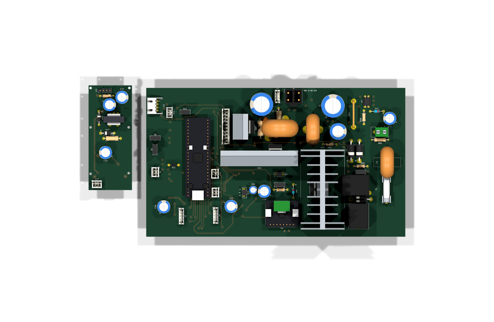
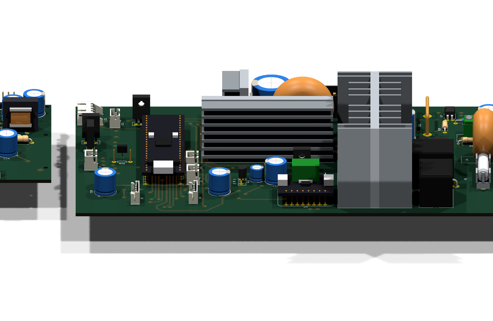
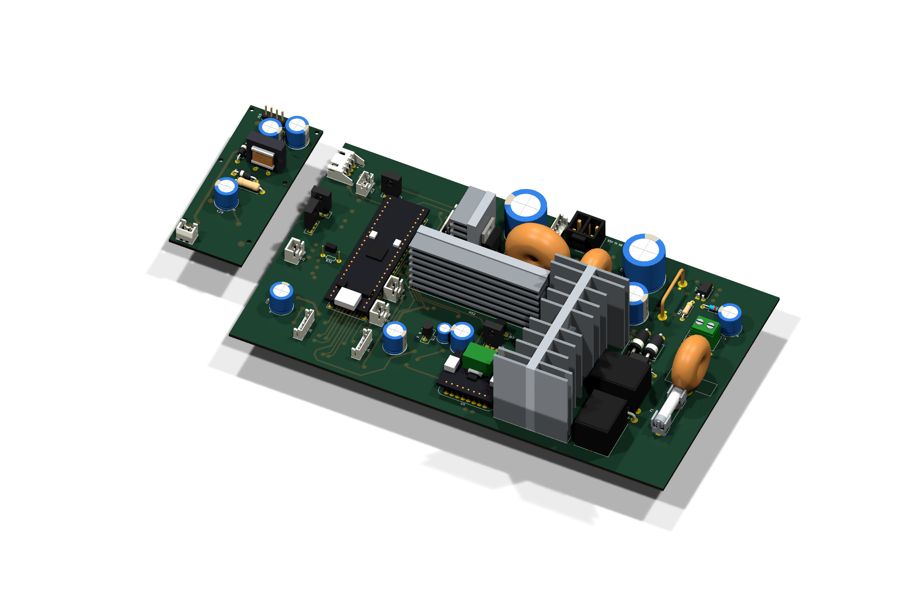
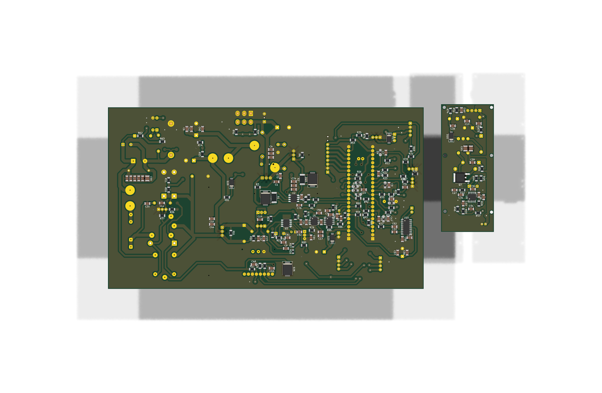

# PCB design and boards

[Русская версия](pcb.ru.md) · [Back to the project overview](../README.md)

> **Status:** both boards have been etched and assembled (November 2026) and the device is working; see the photos in the [README](../README.md). The files and renders on this page are the **v0.2.61 revision (November 2026)**: the bring-up fixes are merged, and the on-board MP9486A 55 → 12 V stage is replaced by a separate [55 → 12 V board](power-55-12v.md).

## Two boards

| Board | Size | Contents |
| --- | --- | --- |
| Main board | approximately 201 × 116 mm, single-sided (B.Cu) + hand-wired jumpers | synchronous buck stage, C–L–C filter, linear post-regulator, metering, protection, output relays, STM32G474 module, +12 V input J13 |
| Auxiliary board | approximately 34 × 82 mm | UC3845 flyback that generates the +67 V and −5 V rails for the OPA454 post-regulator |
| [55 → 12 V board](power-55-12v.md) | approximately 74 × 41 mm, separate KiCad project | UC3845 buck that supplies +12 V from the 55 V rail |

## Power section

The linear pass MOSFET (IRFB4110) sits on a large finned heatsink taken from an audio amplifier; the two buck switches use pieces of a ribbed aluminium profile. All three heatsinks are real footprints in the project library (`HS1`, `HS2`, `HS3`) with mounting-hole pilots and 3D models, so their volume is checked against the rest of the layout.

Both toroidal inductors are ATX-salvage cores, wound and measured rather than bought: L1 = 31 µH on a 25 × 15 × 10 mm core, L3 = 6.3 µH on a 21 × 13 × 7 mm core. The 10 mΩ shunt is a hand-bent constantan staple with Kelvin sense pads.

## Copper layers

The board is etched at home and is **single-sided: the only copper is B.Cu**. KiCad shows four copper layers, but **F.Cu, In1.Cu and In2.Cu are not copper** — they are used to draw the hand-wired connections layer by layer: insulated wire jumpers and twisted pairs (sense lines and other sensitive pairs). Everything on these three layers is wired by hand on the component side, routed clear of the switching node and the inductors; the same note is on the board itself (User.Comments).

⚠️ If you send these files to a fab, export **only B.Cu** as copper (plus the drill and the outline) — otherwise the jumper drawings will be etched as real tracks.

## Conventions you must know before reusing these files

**All drill holes are 0.6 mm and all through-hole pads are at least 2.0 mm.** This is deliberate: when etching at home a large hole eats its own annular ring, so every hole is drilled as a 0.6 mm pilot and opened up by hand afterwards. A 0.6 mm pilot inside a 2.0 mm pad leaves a 0.7 mm ring, which survives a drill that wanders.

⚠️ **If you intend to order these boards from a fab, you must restore the real drill diameters first** — otherwise every hole, including the 2.6 mm heatsink mounts and the connector pins, will arrive at 0.6 mm.

Other project rules:

- SMD passives default to 1206 and SOIC pads are widened to 0.8 mm — everything is meant to be soldered by hand with an iron;
- exposed pads of the HSOP-8 parts are broken out as normal numbered pads (`UCC27211` EP → GND, **`OPA454` EP → V− = −5 V**, not ground);
- power traces that carry the output current are reinforced with soldered copper wire rather than drawn wide.

## Design rule check

The current layout passes DRC with **no clearance or short violations**. What is left is cosmetic (silkscreen over pads, dangling vias and text height) plus two things that still need attention before drilling: the heatsink mounting holes pass close to several tracks, and one courtyard overlap between `R51` and `C37`.

## What is in the hardware folder

See [`hardware/README.md`](../hardware/README.md) for the file list, the custom footprint library, the Python-generated 3D models and the SKiDL netlist generator.
