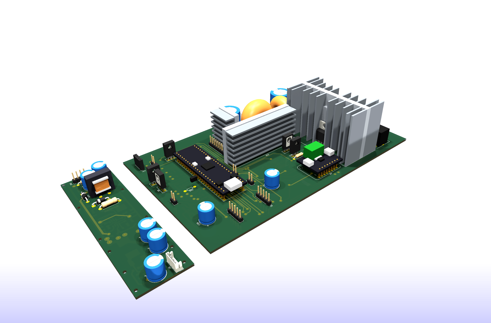
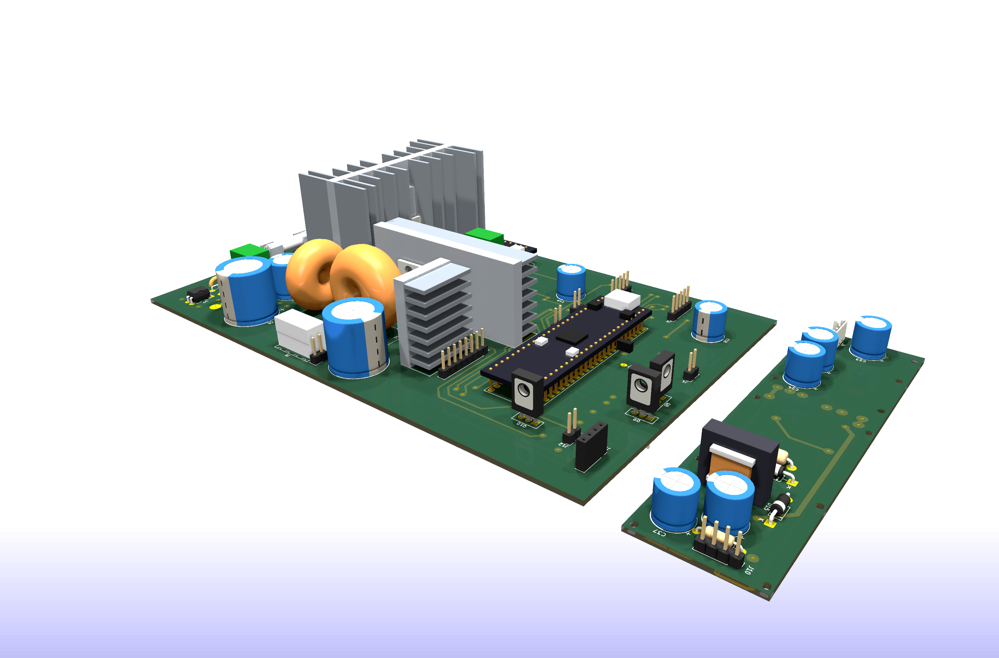
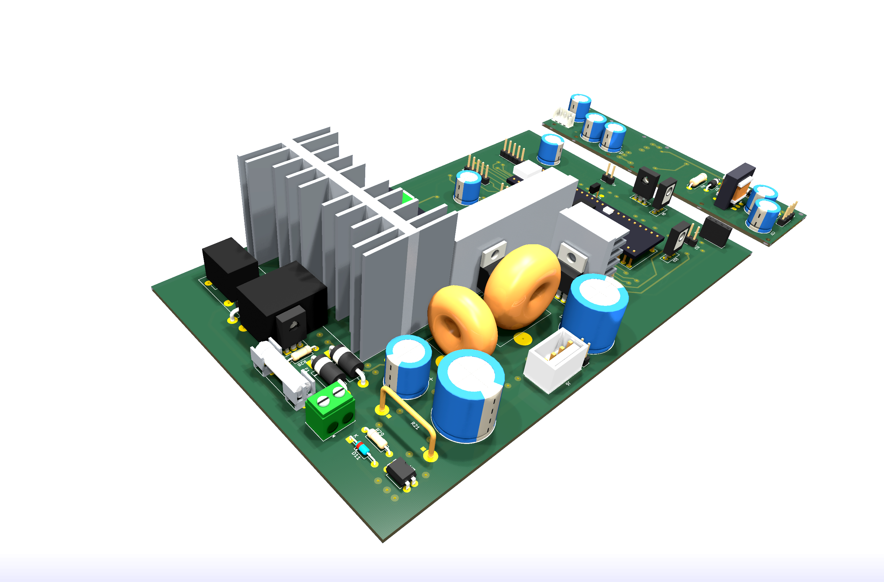
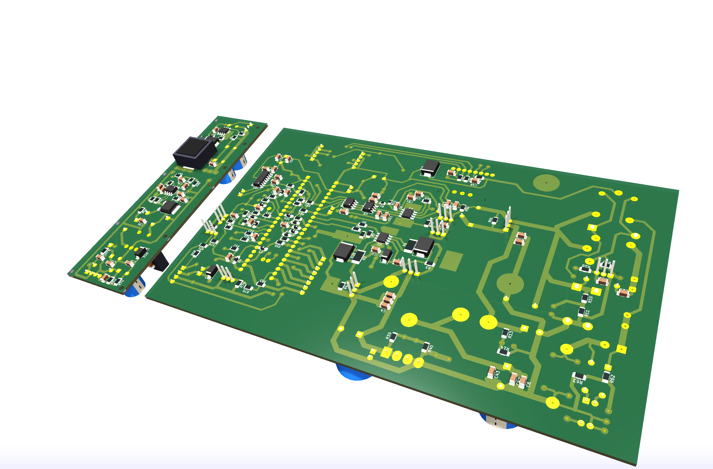

# PCB design and boards

[Русская версия](pcb.ru.md) · [Back to the project overview](../README.md)

> **Status:** layout is complete and the KiCad sources are published, but no board has been etched or brought up yet. Everything below describes the design intent, not measured hardware.

## Two boards

| Board | Size | Contents |
| --- | --- | --- |
| Main board | approximately 260 × 152 mm | synchronous buck stage, C–L–C filter, linear post-regulator, metering, protection, output relays, STM32G474 module |
| Auxiliary board | approximately 148 × 33 mm | UC3845 flyback that generates the +67 V and −5 V rails for the OPA454 post-regulator |

## Power section

The linear pass MOSFET (IRFB4110) sits on a large finned heatsink taken from an audio amplifier; the two buck switches use pieces of a ribbed aluminium profile. All three heatsinks are real footprints in the project library (`HS1`, `HS2`, `HS3`) with mounting-hole pilots and 3D models, so their volume is checked against the rest of the layout.

Both toroidal inductors are ATX-salvage cores, wound and measured rather than bought: L1 = 31 µH on a 25 × 15 × 10 mm core, L3 = 6.3 µH on a 21 × 13 × 7 mm core. The 10 mΩ shunt is a hand-bent constantan staple with Kelvin sense pads.

## Single-sided by design

The board is meant to be etched at home, so all copper is on the bottom layer and the remaining connections are made with insulated wire jumpers on the top side. The jumpers are documented rather than improvised:

- a dedicated `JUMPERS` user layer carries a line for every wire link;
- [`hardware/jumper-wires.txt`](../hardware/jumper-wires.txt) lists all 25 of them with net names, endpoint coordinates and lengths (about 1.33 m of wire in total);
- sense pairs are meant to be twisted, and the wires routed clear of the switching node and the inductors.

In the plot below the etched copper is green and the wire jumpers are the red lines.

## Conventions you must know before reusing these files

**All drill holes are 0.6 mm and all through-hole pads are at least 2.0 mm.** This is deliberate: when etching at home a large hole eats its own annular ring, so every hole is drilled as a 0.6 mm pilot and opened up by hand afterwards. A 0.6 mm pilot inside a 2.0 mm pad leaves a 0.7 mm ring, which survives a drill that wanders.

⚠️ **If you intend to order these boards from a fab, you must restore the real drill diameters first** — otherwise every hole, including the 2.6 mm heatsink mounts and the connector pins, will arrive at 0.6 mm.

Other project rules:

- SMD passives default to 1206 and SOIC pads are widened to 0.8 mm — everything is meant to be soldered by hand with an iron;
- exposed pads of the HSOP-8 parts are broken out as normal numbered pads (`UCC27211` EP → GND, `MP9486A` EP → GND, **`OPA454` EP → V− = −5 V**, not ground);
- power traces that carry the output current are reinforced with soldered copper wire rather than drawn wide.

## Design rule check

The current layout passes DRC with **no clearance or short violations**. What is left is cosmetic (silkscreen over pads, dangling vias and text height) plus two things that still need attention before drilling: the heatsink mounting holes pass close to several tracks, and one courtyard overlap between `R51` and `C37`.

## What is in the hardware folder

See [`hardware/README.md`](../hardware/README.md) for the file list, the custom footprint library, the Python-generated 3D models and the SKiDL netlist generator.
