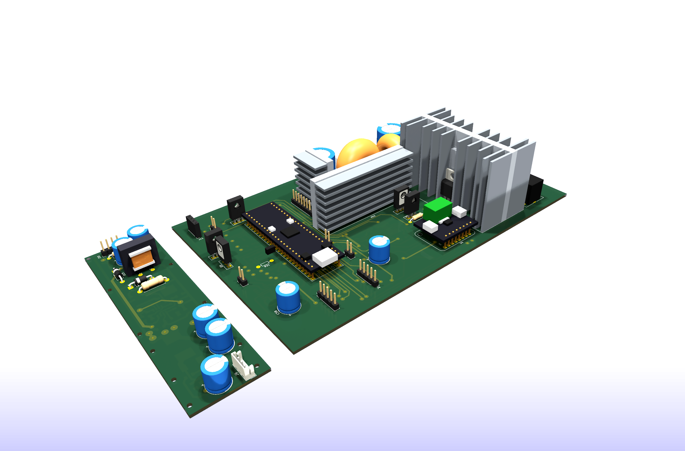
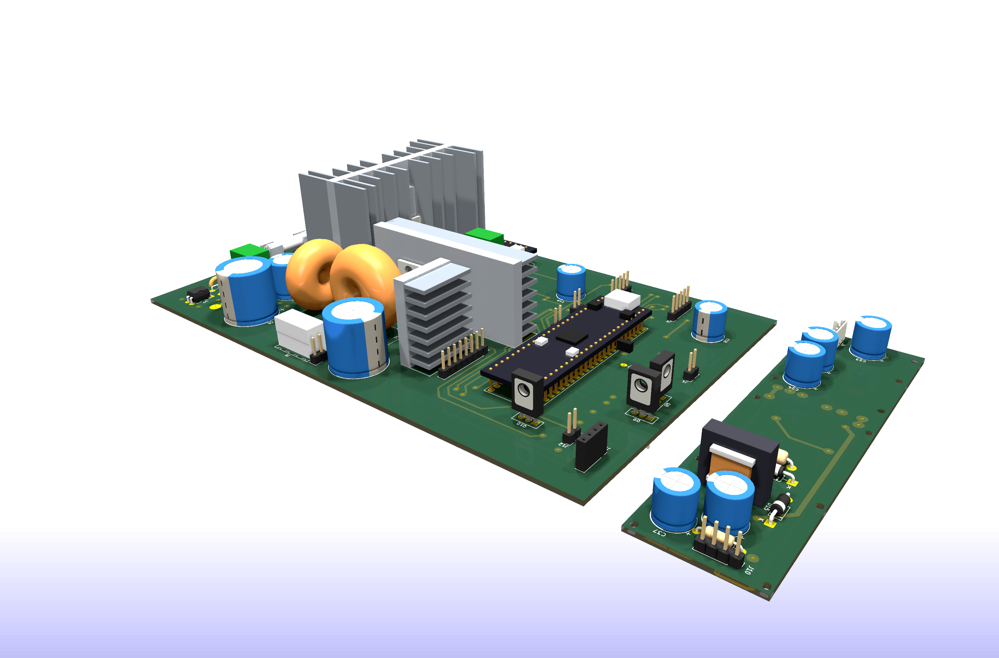
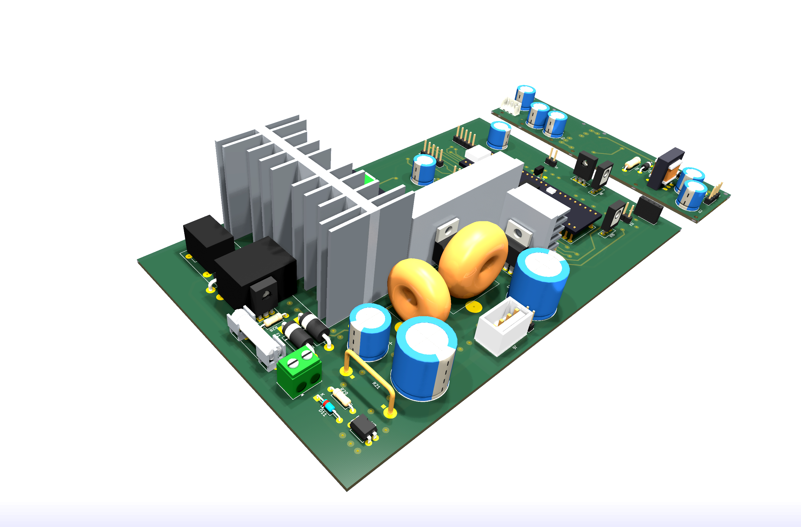
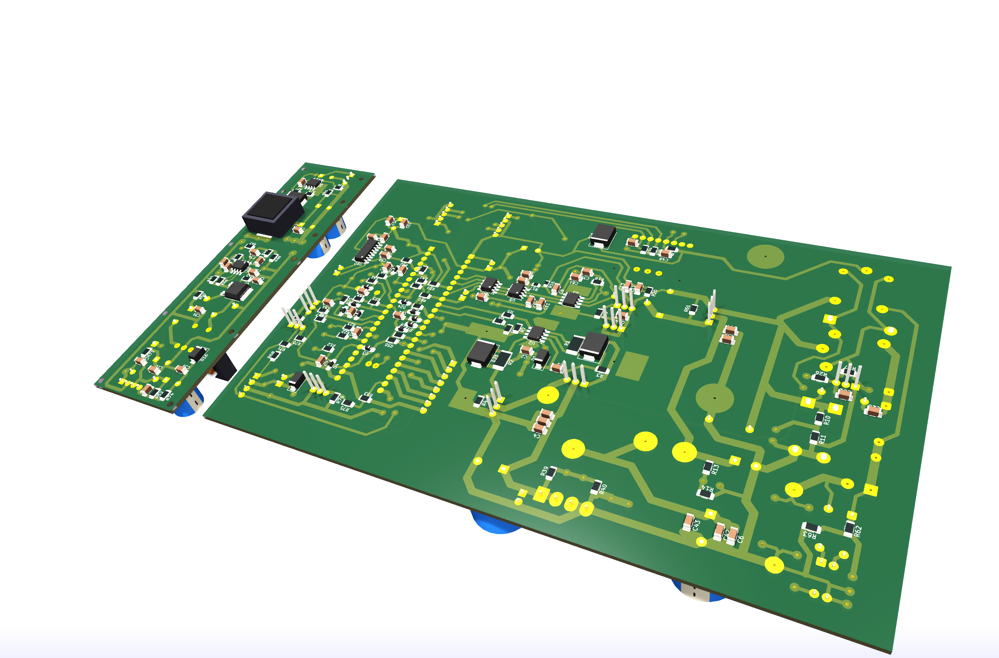

# Печатные платы

[English version](pcb.md) · [К описанию проекта](../README.ru.md)

> **Статус:** разводка завершена, исходники KiCad опубликованы, но ни одна плата ещё не изготовлена и не запущена. Всё написанное ниже — проектное решение, а не измерения на готовом устройстве.

## Две платы

| Плата | Размер | Что на ней |
| --- | --- | --- |
| Основная | примерно 260 × 152 мм | синхронный buck, C–L–C фильтр, линейный пострегулятор, измерение, защиты, выходные реле, модуль STM32G474 |
| Вспомогательная | примерно 148 × 33 мм | флайбэк на UC3845, формирующий +67 В и −5 В для OPA454 |

## Силовая часть

Линейный проходной MOSFET (IRFB4110) стоит на крупном рёбристом радиаторе от усилителя, ключи buck — на отрезках рёбристого алюминиевого профиля. Все три радиатора заведены в библиотеку проекта как настоящие посадочные места (`HS1`, `HS2`, `HS3`) с пилотными крепёжными отверстиями и 3D-моделями, поэтому их объём проверяется относительно остальной компоновки.

Оба тороидальных дросселя намотаны на кольцах от блоков ATX и измерены, а не куплены: L1 = 31 мкГн на кольце 25 × 15 × 10 мм, L3 = 6,3 мкГн на кольце 21 × 13 × 7 мм. Шунт 10 мОм — согнутая вручную константановая скоба с кельвиновскими пятаками.

## Односторонняя по замыслу

Плата рассчитана на домашнее травление, поэтому вся медь на нижнем слое, а недостающие соединения выполняются изолированными проволочными перемычками сверху. Перемычки не импровизируются, а задокументированы:

- отдельный пользовательский слой `JUMPERS` содержит линию на каждую перемычку;
- файл [`hardware/jumper-wires.txt`](../hardware/jumper-wires.txt) перечисляет все 25 штук с именами цепей, координатами концов и длинами (всего около 1,33 м провода);
- сенсорные пары мотать витой парой и уводить от узла SW и дросселей.

На чертеже ниже вытравленная медь зелёная, проволочные перемычки — красные линии.

## Что надо знать до повторения

**Все отверстия 0,6 мм, все выводные пятаки не меньше 2,0 мм.** Это сделано намеренно: при домашнем травлении крупное отверстие съедает собственный поясок, поэтому каждое отверстие сверлится пилотным 0,6 мм и рассверливается по месту. Пилот 0,6 мм внутри пятака 2,0 мм оставляет поясок 0,7 мм — медь переживает уход сверла.

⚠️ **Если вы собираетесь заказать эти платы на фабрике, сначала верните настоящие диаметры свёрл** — иначе все отверстия, включая крепления радиаторов 2,6 мм и выводы разъёмов, приедут по 0,6 мм.

Остальные правила проекта:

- SMD-пассив по умолчанию 1206, пятаки SOIC расширены до 0,8 мм — всё рассчитано на пайку паяльником вручную;
- теплоотводящие площадки корпусов HSOP-8 выведены как обычные нумерованные пятаки (`UCC27211` EP → GND, `MP9486A` EP → GND, **`OPA454` EP → V− = −5 В**, а не земля);
- силовые дорожки выходного тока усиливаются пропаянной медной проволокой, а не шириной рисунка.

## Проверка правил (DRC)

Текущая разводка проходит DRC **без нарушений зазоров и коротких замыканий**. Остаётся косметика (шелкография поверх пятаков, висящие переходные, высота текста) и два пункта, которые стоит закрыть до сверловки: крепёжные отверстия радиаторов проходят близко к нескольким дорожкам, и есть наложение courtyard у `R51` и `C37`.

## Что лежит в папке hardware

Список файлов, библиотека своих посадочных мест, генерируемые скриптом 3D-модели и генератор нетлиста на SKiDL описаны в [`hardware/README.ru.md`](../hardware/README.ru.md).
