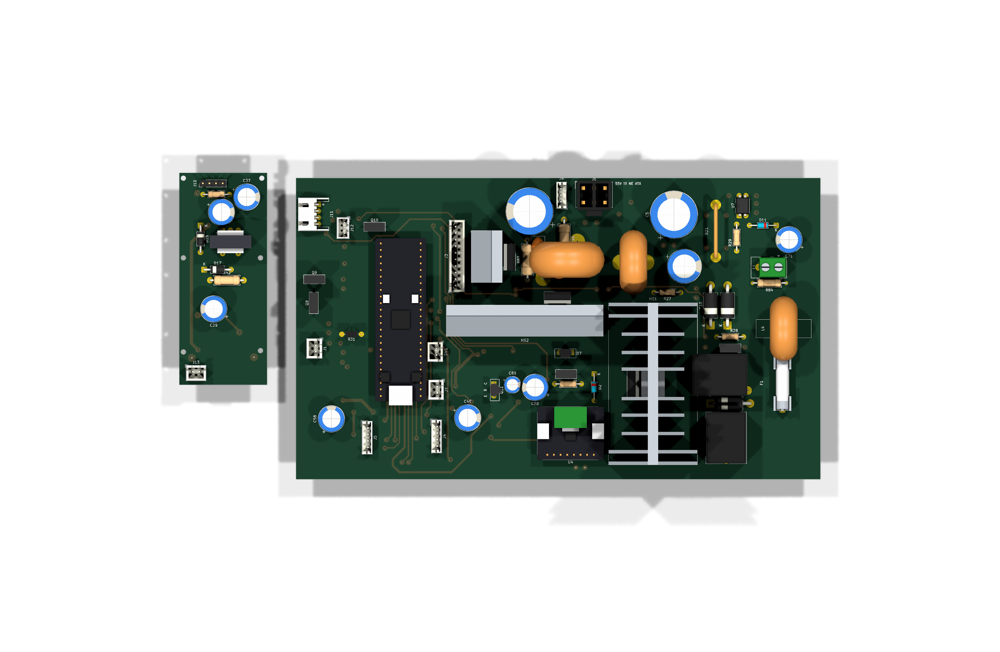
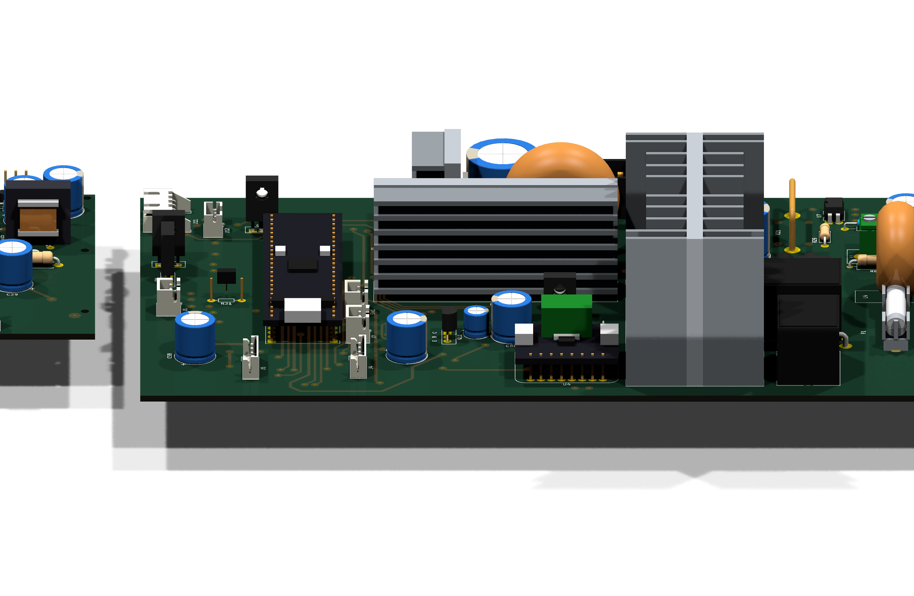
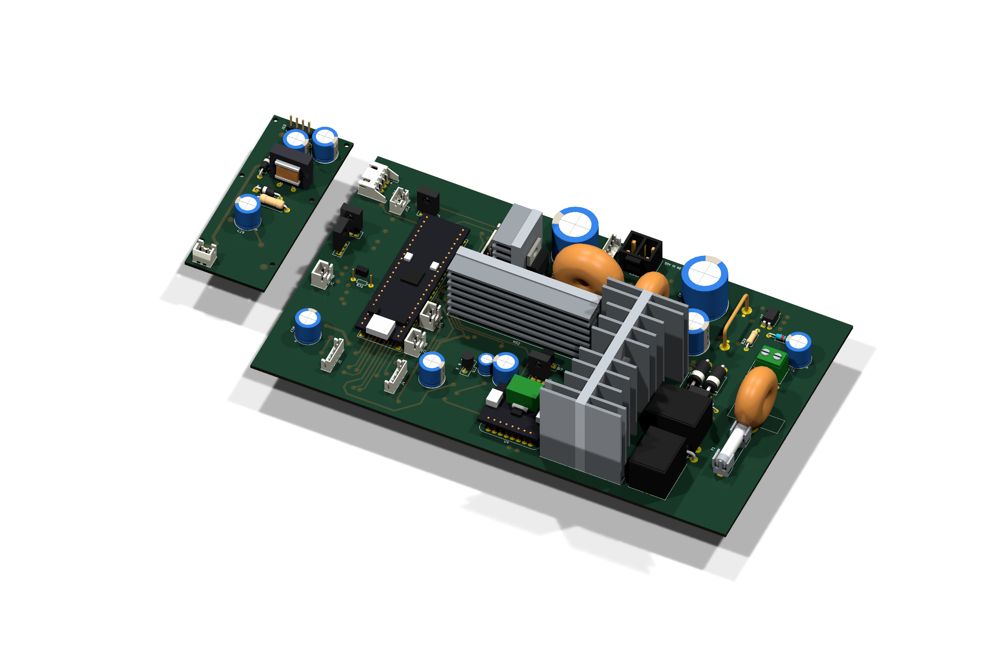
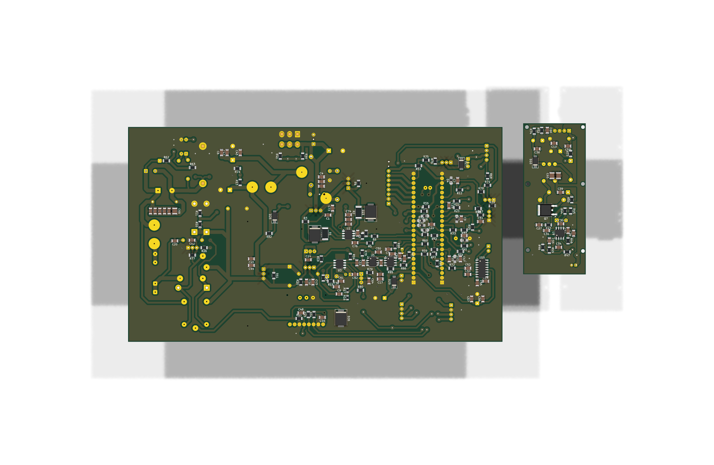

# Печатные платы

[English version](pcb.md) · [К описанию проекта](../README.ru.md)

> **Статус:** обе платы вытравлены и собраны (ноябрь 2026), прибор работает; фотографии — в [README](../README.ru.md). Файлы и рендеры на этой странице — **ревизия v0.2.61 (ноябрь 2026)**: исправления по наладке внесены, а узел 55 → 12 В на MP9486A заменён отдельной [платой 55 → 12 В](power-55-12v.ru.md).

## Две платы

| Плата | Размер | Что на ней |
| --- | --- | --- |
| Основная | примерно 201 × 116 мм, односторонняя (B.Cu) + навесные перемычки | синхронный buck, C–L–C фильтр, линейный пострегулятор, измерение, защиты, выходные реле, модуль STM32G474, вход +12 В J13 |
| Вспомогательная | примерно 34 × 82 мм | флайбэк на UC3845, формирующий +67 В и −5 В для OPA454 |
| [Плата 55 → 12 В](power-55-12v.ru.md) | примерно 74 × 41 мм, отдельный проект KiCad | buck на UC3845, дающий +12 В от шины 55 В |

## Силовая часть

Линейный проходной MOSFET (IRFB4110) стоит на крупном рёбристом радиаторе от усилителя, ключи buck — на отрезках рёбристого алюминиевого профиля. Все три радиатора заведены в библиотеку проекта как настоящие посадочные места (`HS1`, `HS2`, `HS3`) с пилотными крепёжными отверстиями и 3D-моделями, поэтому их объём проверяется относительно остальной компоновки.

Оба тороидальных дросселя намотаны на кольцах от блоков ATX и измерены, а не куплены: L1 = 31 мкГн на кольце 25 × 15 × 10 мм, L3 = 6,3 мкГн на кольце 21 × 13 × 7 мм. Шунт 10 мОм — согнутая вручную константановая скоба с кельвиновскими пятаками.

## Слои меди

Плата травится дома и **односторонняя: медь только B.Cu**. KiCad показывает четыре слоя меди, но **F.Cu, In1.Cu и In2.Cu — не медь**: на них по слоям нарисованы навесные соединения — изолированные проволочные перемычки и витые пары (измерительные линии и другие чувствительные пары). Всё, что на этих трёх слоях, идёт навесом со стороны деталей, подальше от узла переключения и дросселей; та же пометка есть на самой плате (User.Comments).

⚠️ Если отдаёте файлы на производство, выводите как медь **только B.Cu** (плюс сверловку и контур) — иначе рисунки перемычек вытравятся настоящими дорожками.

## Что надо знать до повторения

**Все отверстия 0,6 мм, все выводные пятаки не меньше 2,0 мм.** Это сделано намеренно: при домашнем травлении крупное отверстие съедает собственный поясок, поэтому каждое отверстие сверлится пилотным 0,6 мм и рассверливается по месту. Пилот 0,6 мм внутри пятака 2,0 мм оставляет поясок 0,7 мм — медь переживает уход сверла.

⚠️ **Если вы собираетесь заказать эти платы на фабрике, сначала верните настоящие диаметры свёрл** — иначе все отверстия, включая крепления радиаторов 2,6 мм и выводы разъёмов, приедут по 0,6 мм.

Остальные правила проекта:

- SMD-пассив по умолчанию 1206, пятаки SOIC расширены до 0,8 мм — всё рассчитано на пайку паяльником вручную;
- теплоотводящие площадки корпусов HSOP-8 выведены как обычные нумерованные пятаки (`UCC27211` EP → GND, **`OPA454` EP → V− = −5 В**, а не земля);
- силовые дорожки выходного тока усиливаются пропаянной медной проволокой, а не шириной рисунка.

## Проверка правил (DRC)

Текущая разводка проходит DRC **без нарушений зазоров и коротких замыканий**. Остаётся косметика (шелкография поверх пятаков, висящие переходные, высота текста) и два пункта, которые стоит закрыть до сверловки: крепёжные отверстия радиаторов проходят близко к нескольким дорожкам, и есть наложение courtyard у `R51` и `C37`.

## Что лежит в папке hardware

Список файлов, библиотека своих посадочных мест, генерируемые скриптом 3D-модели и генератор нетлиста на SKiDL описаны в [`hardware/README.ru.md`](../hardware/README.ru.md).
