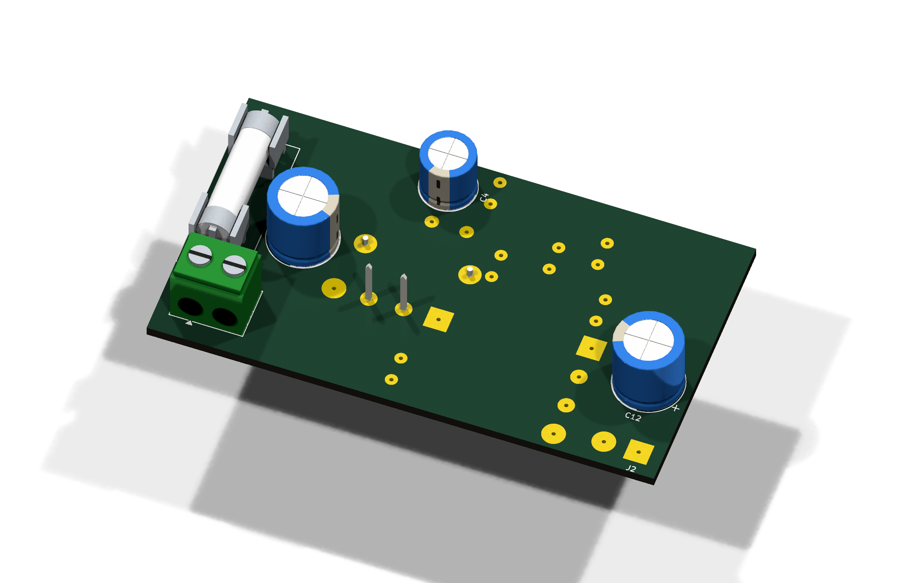
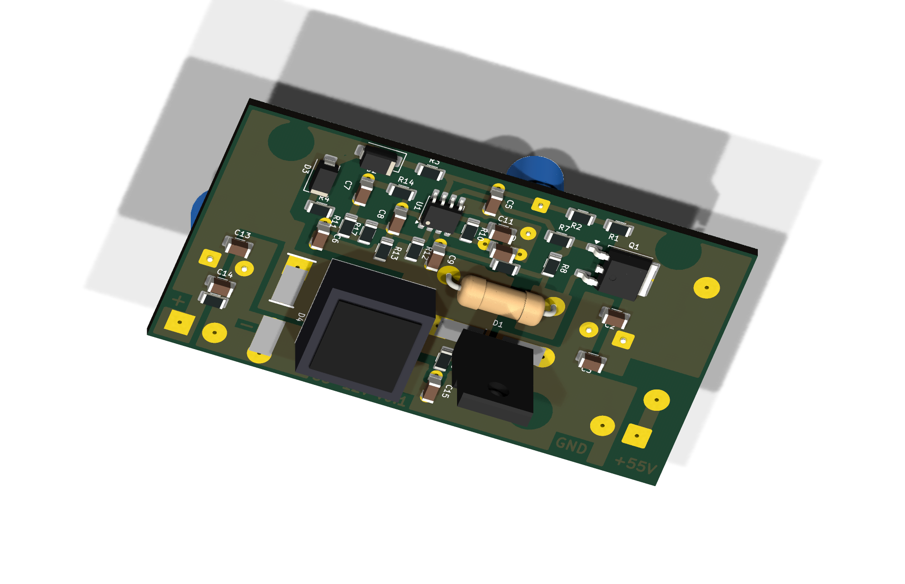

# 55 → 12 V auxiliary supply board

[Русская версия](power-55-12v.ru.md) · [Back to the project overview](../README.md)

A small separate board that makes the +12 V auxiliary supply (buck driver, relays, fans, the +67 V / −5 V flyback) from the 55 V rail. It replaced the on-board MP9486A stage of the first revision, which never ran reliably. It plugs into the main board at **J13 `12V_IN`** (pin 1 = +12 V, pin 2 = GND).

KiCad project: [`hardware/55-12V/`](../hardware/55-12V/) · schematic: [55-12v-schematic.svg](images/55-12v-schematic.svg)

## How it works

- **Buck with a floating controller ground.** The UC3845 sits on the source of the high-side switch Q1: its ground is the switching node behind the current-sense resistor, so an N-channel switch is driven without a bootstrap driver.
- The controller supply and the output-voltage feedback are taken through two diodes from the +12 V output; a resistor chain from 55 V starts it up.
- Q1 60S360P7 (DPAK), L1 68 µH SMD 15 × 15 mm, RT 6.8 kΩ + CT 1 nF ≈ 125 kHz, output diode D1 FML-G12S.
- Protection of the 12 V bus against a shorted switch: fuse F1 2 A and a 15 V TVS (D4, not fitted on the prototype). R15 1 kΩ is a mandatory pre-load; R13 trims the output voltage.

## Measured on the prototype (November 2026)

| Load | Output | Input current from 55 V | Notes |
| --- | --- | --- | --- |
| 47 Ω | 12.03 V | 71 mA | about 80 % at light load |
| 10 Ω (1.19 A) | 11.88 V | 300 mA | efficiency ≈ 86 %, ripple 45 mV, only the diode gets warm |

## Board

About 74 × 41 mm, **single-sided** (all copper on the bottom, SMD parts on the bottom, six through-hole parts on top), no jumpers, every hole a 0.6 mm pilot for home etching. Several footprints are combined (1206 / disc capacitors, 2512 / axial resistors, SMC / axial / TO-220 diode) so whatever is in the drawer fits.

⚠️ Do **not** clip an oscilloscope ground to the controller ground (FGND) — it is the switching node. Before the board starts, up to 4–5 V can appear on the output through the start-up resistors and R15.
