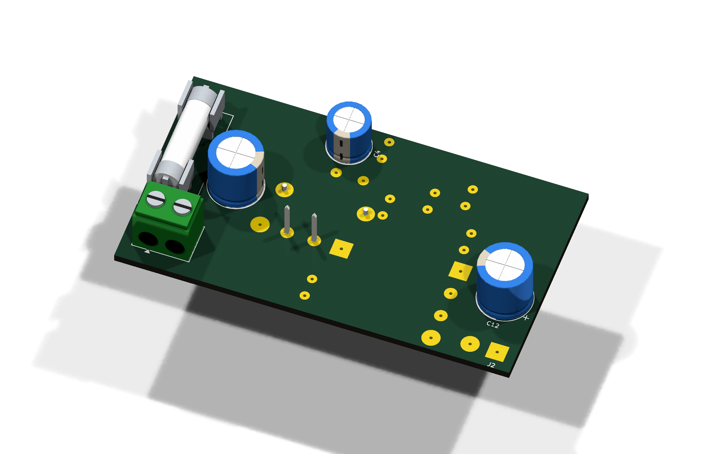
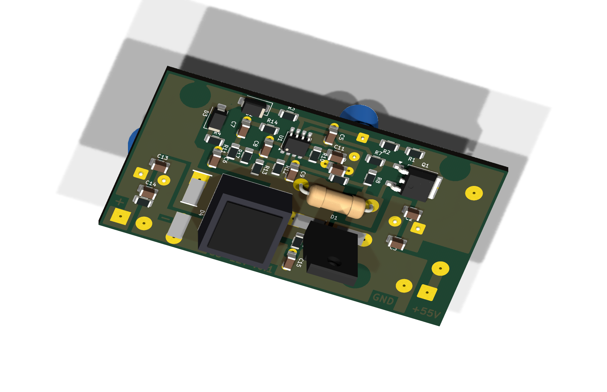

# Плата питания 55 → 12 В

[English version](power-55-12v.md) · [К описанию проекта](../README.ru.md)

Маленькая отдельная плата, которая делает вспомогательное питание +12 В (драйвер buck, реле, вентиляторы, флайбэк +67 В / −5 В) из шины 55 В. Она заменила узел на MP9486A первой ревизии, который так и не заработал надёжно. Подключается к основной плате в разъём **J13 `12V_IN`** (контакт 1 = +12 В, контакт 2 = GND).

Проект KiCad: [`hardware/55-12V/`](../hardware/55-12V/) · схема: [55-12v-schematic.svg](images/55-12v-schematic.svg)

## Как работает

- **Buck с плавающей землёй контроллера.** UC3845 «сидит верхом» на истоке верхнего ключа Q1: её земля — узел переключения за датчиком тока, поэтому N-канальный ключ управляется без драйвера с бутстрепом.
- Питание микросхемы и обратная связь по выходу берутся через два диода с выхода +12 В; запуск — цепочкой резисторов от 55 В.
- Q1 60S360P7 (DPAK), L1 68 мкГн SMD 15 × 15 мм, RT 6,8 кОм + CT 1 нФ ≈ 125 кГц, выходной диод D1 FML-G12S.
- Защита шины 12 В при пробое ключа: предохранитель F1 2 А и супрессор 15 В (D4, на макете не стоит). R15 1 кОм — обязательная преднагрузка, R13 — подстройка выходного напряжения.

## Измерено на макете (ноябрь 2026)

| Нагрузка | Выход | Ток от 55 В | Примечание |
| --- | --- | --- | --- |
| 47 Ом | 12,03 В | 71 мА | около 80 % на малой нагрузке |
| 10 Ом (1,19 А) | 11,88 В | 300 мА | КПД ≈ 86 %, пульсации 45 мВ, тёплый только диод |

## Плата

Примерно 74 × 41 мм, **односторонняя** (вся медь снизу, SMD снизу, шесть выводных деталей сверху), без перемычек, все отверстия — пилотные 0,6 мм под домашнее травление. Часть посадочных мест комбинированные (конденсаторы 1206 / «таблетка», резисторы 2512 / выводные, диод SMC / выводной / TO-220) — встаёт то, что есть в запасах.

⚠️ Землю щупа осциллографа на землю контроллера (FGND) **не цеплять** — это узел переключения. До запуска через пусковые резисторы и R15 на выходе может стоять до 4–5 В.
